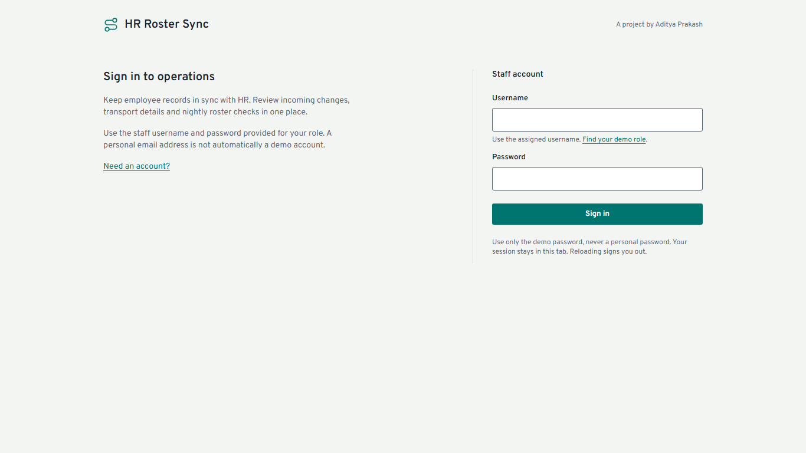
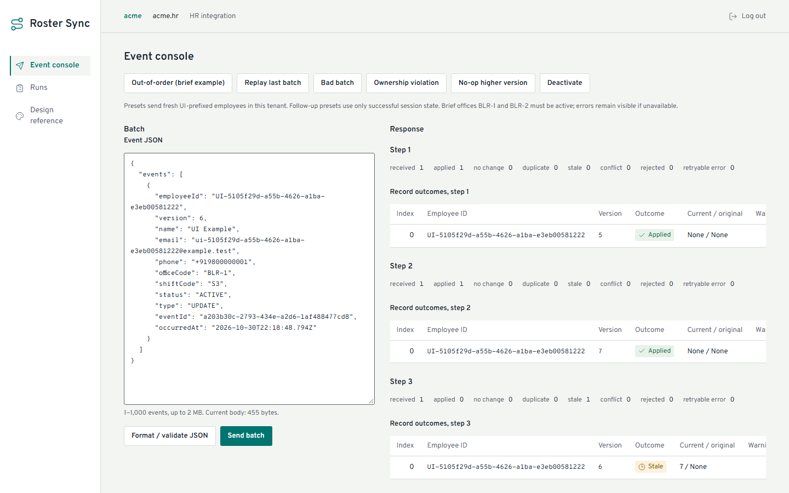
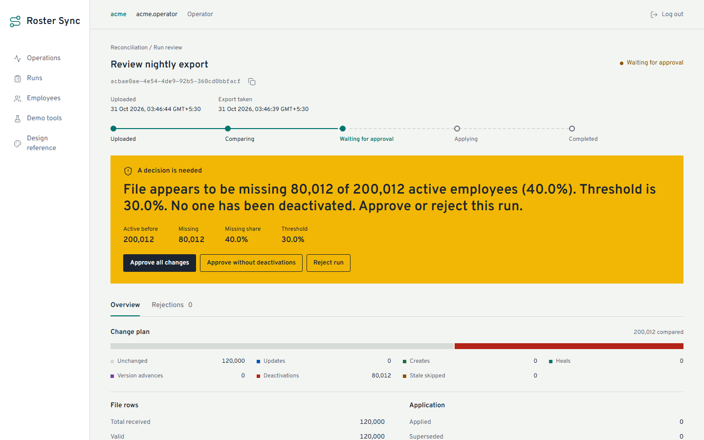
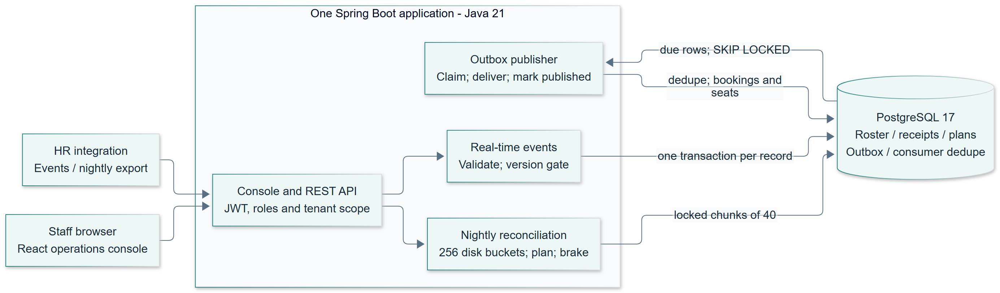
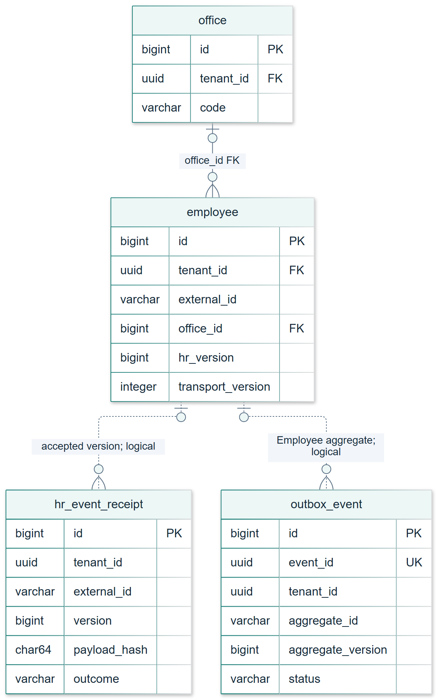
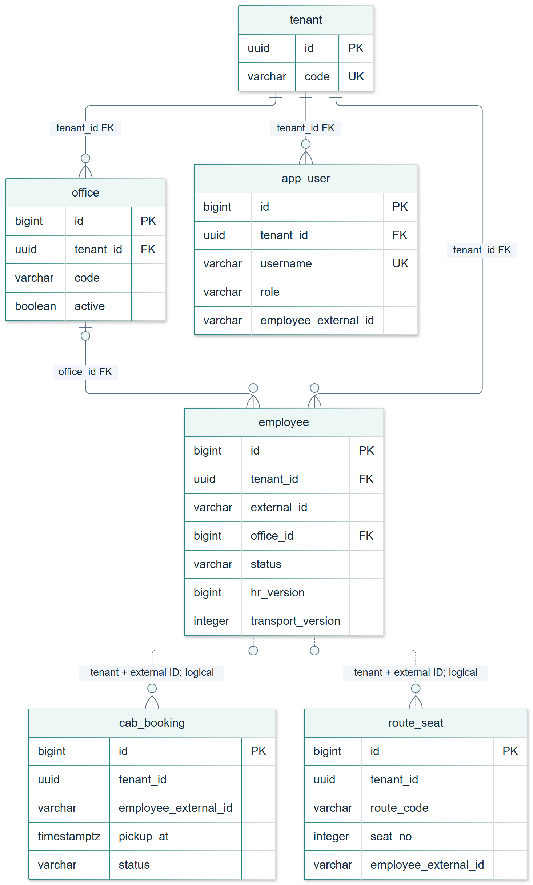
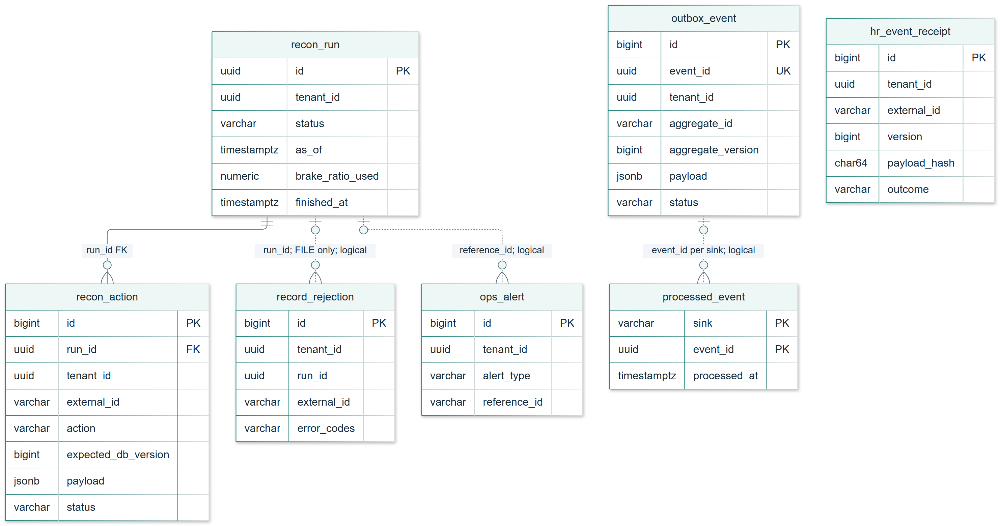

# HR Roster Sync

### Keeping employee records correct when HR changes arrive late, twice, or not at all

Built by **Aditya Prakash** for **MoveInSync Backend Case Study 5, Advanced Track**.

**Live application: [rostersync-aditya.duckdns.org](https://rostersync-aditya.duckdns.org)**

**Demo credentials are provided privately.** The application uses prepared staff accounts with company and role permissions. Your personal email address does not automatically create an account. On the sign-in screen, choose **Need an account?** to find the appropriate demo username.


Java 21 · Spring Boot 4.1 · PostgreSQL 17 · React · Docker Compose

## The problem this project solves

A transport roster depends on employee information from HR: who is active, which office they work in, and which shift they follow. Real feeds are imperfect. A request may be delivered twice after a timeout. An older update may arrive after a newer one. A nightly export may stop halfway through. Treating arrival time as the source of truth can leave an employee at the wrong office, repeat a side effect, or deactivate thousands of people because a file was incomplete.

HR also does not own every field. The transport team maintains pickup points and special-assistance details. A later HR import must preserve those values, even if its payload includes them.

HR Roster Sync handles these problems through two paths. During the day, it validates and applies versioned employee events independently. At night, it compares a full HR export with the stored roster, repairs differences, and pauses suspicious plans for an operator. Both paths use the same ownership and version rules, and changes reach downstream consumers through a durable outbox.

### A concrete example

An employee is created at **version 5**. A **version 7** event transfers them to a new office. Then **version 6** arrives with an older shift change. The service reports the last event as `STALE` and keeps the complete version-7 state. Sending version 7 again with the same content returns `DUPLICATE`, without changing the employee or adding another outbox event.

The nightly example is different: an export contains only **120,000 rows** for a store of roughly **200,000 active employees**. The missing share crosses the default **30%** threshold. The service records the plan and an alert, applies **zero** changes, and waits for an operator to approve or reject it.

## Guide to the repository

- [Try the application](#try-the-application): accounts, screens and the two examples from the brief.
- [How it works](#how-it-works): the two input paths, transaction boundary and crash recovery.
- [Run locally](#run-locally): one-command setup, scripted proof and monitoring.
- [Rules behind the results](#rules-behind-the-results): replay, versions, ownership and the safety brake.
- [Performance](#performance): measured workloads, machine specification and scaling limits.
- [Tests and failure proof](#tests-and-failure-proof): commands, counts and the invariants tested.
- [Deployment and trade-offs](#deployment-and-trade-offs): the Sydney deployment and deliberate limits.
- [Documentation map](#documentation-map): contracts, design decisions and requirement coverage.

## Try the application

Open **[rostersync-aditya.duckdns.org](https://rostersync-aditya.duckdns.org)** and use the demo password supplied privately. This is a staff application, so accounts are prepared with a company and a role. Public self-registration is not enabled. The access-help page explains the available roles and can fill in a username; it cannot grant permissions or bypass the password.

| Username | Role | What to try |
|---|---|---|
| `acme.hr` | HR integration | Open Event console and run **Out-of-order (brief example)**. Inspect the three results, then replay the last batch. |
| `acme.admin` | Transport admin | Find `E1001` in Employees. Inspect the HR fields, edit transport details and review bookings. |
| `acme.operator` | Operator | Open Operations for current state and delivery problems. Use Runs to inspect a reconciliation plan and its decision. |
| `E1001` | Employee | Open My profile. This role can view its own information and bookings. |

Role checks happen on the server as well as in the navigation. An operator cannot edit transport fields, an employee cannot read another employee, and a permitted role from another tenant receives 404 for the first tenant's resources. Tokens stay in the current tab's memory, so reloading deliberately signs out.

### What the console shows

**Staff access.** Sign-in explains the prepared accounts and links to a role guide. The form keeps the action visible after an unsuccessful attempt, with a support reference available when needed.



**Event decisions.** The event console sends real API requests and displays the result for each record. The version route line follows arrival order, so the late version 6 appears after version 7 rather than looking as though it arrived earlier. A replay shows its original outcome as well as `DUPLICATE`.



**A decision before deactivation.** Run review separates the file's export time from upload time, shows the missing share and recorded threshold, and presents the operator's choices before anything from a suspicious plan is applied. The screenshot below is a synthetic rehearsal, not a fixed count every new run must reproduce.



The [operations board](docs/images/console-ops.png) connects durable tenant counts with delivery problems and alerts. The [employee view](docs/images/console-employee-detail.png) separates HR-owned fields from transport-owned fields. The [runs list](docs/images/console-runs.png) keeps the history of uploaded files and decisions.

The full 200k demonstration runs locally. In Demo tools, seed 200,000 once, generate a truncated 120,000-row export, then upload it. The small AWS instance is for the light interview demonstration. Its `prod,demo` profile is an intentional exception: demo tools still require OPERATOR authorization. No demo password appears in the application, repository or screenshots.

<details>
<summary>Verify the live API in two minutes with Bash, curl and jq</summary>

These five lines check the public page, sign in without printing the token, read offices, and confirm that the same endpoint requires authentication. Enter the private demo password at the hidden prompt. Do not turn on shell tracing.

```bash
BASE=https://rostersync-aditya.duckdns.org; curl -sS -o /dev/null -w 'Console: %{http_code}\n' "$BASE/"
read -rsp 'Private demo password: ' DEMO_PASSWORD; echo
TOKEN=$(jq -n --arg password "$DEMO_PASSWORD" '{username:"acme.admin",password:$password}' | curl -fsS "$BASE/api/v1/auth/token" -H 'Content-Type: application/json' --data-binary @- | jq -er .accessToken)
curl -fsS "$BASE/api/v1/offices" -H "Authorization: Bearer $TOKEN" | jq
curl -sS -o /dev/null -w 'Without a token: %{http_code} (expected 401)\n' "$BASE/api/v1/offices"; unset DEMO_PASSWORD TOKEN
```

The [Postman collection](postman/roster-sync.postman_collection.json) and [environment template](postman/roster-sync.postman_environment.json) provide the same API flows. Fill the private password locally. Login responses contain a JWT, so do not display them in a public recording.

</details>

## How it works



[Open the architecture as a vector diagram](docs/diagrams/system-context.svg).

The public deployment runs **one Spring Boot app and one PostgreSQL primary**, with Caddy terminating HTTPS on ports 80/443. The React console is built into the Java image as static files. Node is a build tool, not a production service. API controllers enforce roles and tenant scope; application services own transactions; plain Java classes decide validation, versions, ownership and reconciliation outcomes.

The outbox publisher is a background worker in that same app. It delivers committed changes to the logging and deactivation sinks. No message broker is required. Uploaded files and temporary buckets use private disk storage. Actuator uses port 8081, bound to host loopback in AWS and accessed through SSM; Prometheus/Grafana belong to the optional local monitoring profile.

### Data model: current state, accepted versions and pending delivery



This is the core of the model, with selected columns. **Solid lines are declared SQL foreign keys; dotted lines are application-level associations.** Employee IDs are unique within a tenant, not globally. A tombstone may have no office. Receipts identify accepted content by `(tenant_id, external_id, version)`, while outbox rows identify downstream deliveries by `event_id`.

The employee has separate `hr_version` and `transport_version` values because the two sources own different fields. Replaying an event checks its receipt; it does not create another employee change or delivery. The employee update, accepted receipt and new outbox row commit together when business fields change.

<details>
<summary>Expand the tenant, staff-account, booking and seat relationships</summary>



Office codes are unique on `(tenant_id, code)`; employees on `(tenant_id, external_id)`; route seats on `(tenant_id, route_code, seat_no)`. Staff usernames are globally unique. Booking/seat employee references and the EMPLOYEE account mapping are resolved by the application using tenant plus external ID; they are not employee foreign keys.

</details>

[Core ER as SVG](docs/diagrams/roster-key-erd.svg) · [Workforce ER as SVG](docs/diagrams/workforce-erd.svg) · [Full column definitions](docs/DATA_MODEL.md)

<details>
<summary>Expand the reconciliation, audit and delivery ER diagram</summary>



`recon_run` records the uploaded snapshot and operator decision; `recon_action` records the durable plan. `record_rejection` stores safe codes rather than rejected values. `processed_event` remembers delivery per sink. The accepted receipt ledger, nightly plan and consumer ledger answer different questions, so they are separate tables.

</details>

The [schema guide](docs/SCHEMA_GUIDE.md) explains each relationship and key. The [full 14-table ER map](docs/diagrams/schema-full.svg) includes settings and the logical links between both views. Its dotted links do not imply extra SQL foreign keys or automatic cascading deletes.

### During the day: validate, decide and commit one event

The API first checks authentication, role and company scope. For each parsed event, the application filters fields by ownership, normalises the allowed values and returns all validation errors in a deterministic order. An invalid record is rejected independently, so its valid neighbours can still apply.

For a valid record, a transaction reserves the employee-version receipt, locks the employee row, and decides what to change. The employee update, final receipt and outbox insert commit together. Concurrent requests for the same key use PostgreSQL's unique constraint as the arbiter. A transaction that rolls back leaves no partial state or consumed key. Business decisions live in plain Java classes such as `ChangeDecider`; the application service owns the transaction.

### At night: compare a full export before applying a plan

The upload becomes a durable reconciliation run. The service reads the CSV as a stream, validates its records and spills them into 256 buckets by employee ID. It compares one bucket at a time with the matching database rows, rather than building two complete in-memory maps.

The resulting plan includes creates, updates, repairs, version advances and eligible missing-employee deactivations. The safety brake checks row-count integrity and missing employees before apply starts. A safe plan applies in small transactions. A suspicious plan waits for a human decision. Each chunk rechecks versions under employee-row locks, so a real-time update can supersede an older planned action.

### After commit: deliver changes and recover safely

An outbox row is a pending delivery record stored with the employee change. The publisher claims one due row in a short transaction, calls the sinks with a timeout, and marks publication. Failures get backoff and eventually a DEAD state with one operator alert. Retrying rows do not block later due rows.

Delivery is **at least once**. A sink may finish before the publisher crashes, or may finish after its timeout. Consumers therefore remember processed event IDs and check current employee state. The deactivation handler cancels only future scheduled bookings and frees seats. Its employee lock prevents a delayed old deactivation from cancelling a rehire's newer bookings.

See the [detailed architecture](docs/DESIGN.md), [two-page design note](docs/DESIGN.pdf) and [crash-after-delivery sequence](docs/diagrams/outbox-recovery.png). The diagrams are original to this repository and have editable SVG/source files in [docs/diagrams](docs/diagrams/).

## Run locally

**Required:** Docker Engine or Docker Desktop with Compose. The container build includes the frontend and Java build, so host Node, Maven and Java are not required to run the application.

```bash
cp .env.example .env
docker compose up --build
```

Open [localhost:8080](http://localhost:8080/). Set the local demo password in `.env` and use one of the staff usernames above. PostgreSQL starts first and Flyway applies the schema automatically. Keep `.env` private. On PowerShell, use `Copy-Item .env.example .env` and `curl.exe`; the demonstration scripts run in Git Bash on Windows or Bash on Linux with curl and jq installed.

| Service | Address | Access |
|---|---|---|
| Console and API | `http://localhost:8080` | Sign-in is public; staff API calls require a bearer token |
| Readiness and metrics | `http://127.0.0.1:8081/actuator/health/readiness` | Published to host loopback only |
| PostgreSQL | Compose network | No published host port |

<details>
<summary>Building on a network that requires an HTTP proxy</summary>

Set HTTP_PROXY and HTTPS_PROXY in your shell, with NO_PROXY for local addresses, then run the same Compose build. Optional build arguments default to empty and cover both uppercase and lowercase names because tools handle them differently. Keep actual proxy addresses and credentials out of the repository. Docker Desktop's registry access has its own proxy settings; build arguments configure the build steps, not the image-registry connection. Do not disable certificate verification to work around a proxy.

</details>

### Reproduce the live flows

```bash
DEMO_AUTO=1 ./scripts/demo.sh
```

This runs the mixed-feed replay, ordering, invalid-record and ownership checks, 200k reconciliation, truncated-file brake, real process crash and booking effects. It uses unique IDs and waits for prior active runs, rejecting leftover awaiting plans. Unexpected outcomes make automated mode fail. Allow the async run/delivery waits to finish. The [demo guide](docs/DEMO_SCRIPT.md) lists the expected result at each step.

For the isolated crash proof, run `./scripts/demo-crash.sh`. It retains the exit-137/restart evidence and requires publication of the exact event ID after recovery. Avoid destructive volume cleanup on a dataset you want to retain.

### Add local monitoring

Set `GRAFANA_ADMIN_PASSWORD` privately in `.env`, then run:

```bash
docker compose --profile monitoring up -d
```

Prometheus is at `http://127.0.0.1:9090`, Grafana at `http://127.0.0.1:3000`. The provisioned dashboard shows event outcomes, queue depth, retry/failure rates, reconciliation decisions and apply percentiles. Database-backed gauges refresh in the background; a scrape does not query PostgreSQL. Default Compose starts only app and db, and the AWS deployment does not run these monitoring services.

## Rules behind the results

### Replay uses an employee-version key and canonical content

The idempotency key is **(tenantId, employeeId, version)**. An eventId is informational. For an accepted key, the service compares a SHA-256 hash of event type plus canonical HR-owned fields after ownership filtering and normalisation. The hash excludes eventId and occurredAt, so changing only those delivery attributes does not create another business change.

Matching accepted content returns `DUPLICATE` with its `originalOutcome`. Different type or content for that accepted key returns `CONFLICT`, leaves its receipt unchanged and writes safe rejection audit. Rejected input does not consume a receipt, so a corrected resend can use the same key.

### Source versions decide which state wins

When no accepted receipt matches, the incoming version is compared with the employee's current HR version:

| Incoming state | Outcome | Effect |
|---|---|---|
| Newer, HR-owned values changed | `APPLIED` | Update employee/version and write exactly one Employee outbox event |
| Newer, identical resolved state | `NO_CHANGE` | Advance version and timestamp without a business event |
| Older | `STALE` | Keep the current employee state and version |
| Equal, identical state | `DUPLICATE` | Keep the current employee state |
| Equal, different state | `CONFLICT` | No employee/outbox write; record safe rejection audit |

CREATE and UPDATE carry **full HR snapshots**, not partial patches. That is why version 7 contains enough information to remain correct when version 6 arrives later. Timestamp-only sources must supply an increasing epoch-millisecond version. DEACTIVATE needs only employeeId and version; an unknown employee becomes an inactive tombstone. A higher-version no-op still advances the watermark, preventing intermediate stale CREATE events from resurrecting that employee.

### Ownership is explicit, even when the sources disagree

HR owns name, email, phone, manager, office, shift and status. Transport owns pickupPoint and specialAssistance. HR input for transport fields is ignored with `FIELD_NOT_OWNED_BY_SOURCE`. A transport PATCH rejects HR-owned keys. In that PATCH, null means clear and an absent key means unchanged. Ownership is never resolved by choosing whichever payload arrived last.

Email is trimmed and lowercased before validation and hashing. Phone must already be E.164; spaces and dashes are rejected. Diagnostics return field/code pairs without echoing rejected input values.

### The brake stops the whole suspicious plan

The default missing-ratio rule trips at **missing share >= 30%**, including the exact boundary. Optional missing-count and trailer/expected-row-count checks can also stop a run. With zero active employees, ratio/count checks are skipped, but row-count integrity checks still apply.

A tripped plan changes nothing until an OPERATOR chooses to approve all changes, approve without deactivations, or reject it. Saving a new threshold affects the **next** run; an existing plan retains its recorded setting. A snapshot can also heal equal-version drift and advance higher identical versions. See [reconciliation rules](docs/RECONCILIATION.md) and the [complete API contract](docs/API.md).

## Performance

Local machine: **Intel Core i5-1240P**, 12 physical / 16 logical cores, **15.69 GiB RAM**, Windows 11 build 26200. Docker Desktop Engine 29.9.2 uses 16 logical CPUs and **7.60 GiB** VM memory. Host JDK 22.0.1 compiles release 21; Docker uses Temurin 21. Results below are local measurements, not AWS latency guarantees.

| Workload | Measured result |
|---|---|
| Exact 200,000-row snapshot; 256 MiB heap | **16.571 s** dry-run wall time; **104.84 MiB** sampled peak heap |
| Mixed export against 200,000 employees; median of 3 runs | **13.306 s** dry-run wall time; **120.14 MiB** sampled peak heap |
| Reconciliation apply, default chunk 40 | **313.5 actions/s** in the final recheck; prior repeats 296.5–304, so a 300/s floor is not consistent |
| Committed chunks, including cold work | p50 **120.9 ms**, p99 **301.2 ms**, max **1,174.4 ms** |
| Single-event HTTP, 5 VUs / 60 s | **59.0 events/s**; p50 **71.18 ms**, p99 **235.36 ms** |

Final audit: 2026-10-31. The mixed file contains 199,190 rows after controlled drops/new rows; the exact-size case runs before the mixed samples in the same fork, so their comparison path is warmed. This is a recheck, not a claimed code optimization. The separate k6 measurements below are the 2026-10-30 baseline. The exact 200,000-row final-audit case is reported in [performance evidence](docs/PERFORMANCE.md). Chunk acceptance is p99 <1 s **and** max <2.5 s, including commit and cold work; it passes with chunk 40.

Batch-size-50 scaling, with synchronous commit **on**:

| VUs | Events/s | Request p50 / p99 (ms) | Per-event p50 / p99 (ms) | Max Hikari pending | PG commits/s |
|---|---:|---:|---:|---:|---:|
| 1 | 75.9 | 650.6 / 933.1 | 13.01 / 18.66 | 0 | 96.2 |
| 5 | 245.1 | 985.6 / 1,380.6 | 19.71 / 27.61 | 0 | 243.4 |
| 10 | 322.1 | 1,446.4 / 2,502.7 | 28.93 / 50.05 | 0 | 301.2 |
| 20 | 405.0 | 2,325.4 / 3,832.8 | 46.51 / 76.66 | 1 | 372.9 |

Per-event batch figures are **request duration / 50**, an amortized cost rather than an individual response latency. PG commits/s uses `xact_commit` delta over the enclosing measured wall window, including publisher/observer work.

1. Scaling bends above 5–10 VUs: doubling 10 to 20 VUs adds 26% throughput while request p99 rises 53%.
2. A diagnostic `synchronous_commit=off` run reached 492 events/s (+21.5%), showing durable commit I/O contributes; the setting was restored to **on**. This is not the production configuration.
3. Pool pending remained near zero, so the pool stays at 20. The outbox backlog reached 22,260 rows: 405 events/s is an ingress burst rate, not sustained end-to-end delivery capacity.

Event application uses O(log M) indexed lookup and O(1) working state. Bucketed comparison is O(N + M) time and expected O((N + M)/256) working heap, plus O(N) spill disk; skew can increase the largest bucket. Mass-change apply is bounded by writes/outbox work, and multiple instances would need leases and shared upload storage. [All samples, before/after profiling and cold-JIT variation](docs/PERFORMANCE.md).

## Tests and failure proof

```bash
./mvnw -B verify                 # JDK 21+, Docker; unit, property, guard and PostgreSQL integration tests
./mvnw -B verify -Pbenchmark     # also constrained-heap benchmarks; manual/weekly CI only
cd frontend
npm ci                          # Node 24 LTS, frontend checks only
npm run lint && npm run lint:design && npm run typecheck && npm test && npm run build
```

On PowerShell use `.\mvnw.cmd`. Docker/CI use Temurin 21. Maven verification works without Node.

| Evidence | Latest verified count |
|---|---:|
| Backend unit/web/property/architecture guards | 162 (including two fixed-seed properties with 1,000 tries each) |
| PostgreSQL integration | 162 |
| Normal backend verification | **324 passed** |
| Frontend unit | **26 passed** |
| Real-Compose browser cases | **17 passed**, including **60** axe scans with zero serious/critical findings |
| Deployed console checks | **6 passed** across roles, themes, desktop/mobile and live event/reconciliation flows; account help, username prefill and failed-sign-in reflow also checked at 1440, 1280 and 390 px |
| Authenticated Lighthouse accessibility | **100/100** on Runs and Employees, light/dark |

The reviewed production build’s initial JS is about 110.40 kB gzip. Browser checks cover role menus, memory-only login, transport null/no-op behavior, all six event presets, safe errors and the real brake/rejection workflow. [Reproducible commands and complete test catalogue](docs/TESTING.md).

The crash tests cover failure before commit, after commit before publication, and after a consumer commit before publication acknowledgement. Outbox delivery is at least once: a timeout does not stop a sink, so consumers deduplicate and re-check employee status. Lock retries occur outside record transactions; failed reconciliation chunks roll back before fallback. [Failure table and recovery sequence](docs/DESIGN.md#hardest-flow-crash-after-delivery).

## Deployment and trade-offs

The live application runs on one **t4g.small in Sydney (ap-southeast-2)** with app, PostgreSQL and Caddy. Caddy terminates HTTPS and redirects HTTP. Only ports 80 and 443 are public. Management port 8081 binds to instance loopback and is reached through SSM port forwarding; ports 22, 5432, 8080 and 8081 remain closed to the internet. The chosen region accepts about 150 ms added latency from India, so local benchmark numbers are not live-network latency guarantees.

The host has a 2 GB swap file, JVM `-Xmx768m`, PostgreSQL `shared_buffers=256MB`, Docker log rotation and encrypted S3 backups. Secrets live in SSM SecureString and are retrieved privately. The deployment guide includes credential retrieval, management forwarding, backup/reboot checks and [stop/start/teardown commands](deploy/aws-ec2/TEARDOWN.md). See [DEPLOYMENT.md](docs/DEPLOYMENT.md) for the exact setup.

The service fails closed if PostgreSQL is unavailable because it cannot safely claim an ordered durable write without its authority. Per-record transactions isolate bad records but increase large-batch response time. Consumer deduplication makes repeated delivery safe without claiming exactly-once sink execution. Local Caffeine caches keep read latency low, with bounded TTLs and after-commit eviction; in-transaction office validation stays uncached.

The tested runtime assumes one app instance/poller and one PostgreSQL primary. Before adding instances, reconciliation needs durable worker ownership and shared upload storage, and caches need a cross-instance invalidation strategy or accepted TTL staleness. A broker, Kubernetes, a full identity provider and in-flight run cancellation are deliberate omissions. Disabling an account prevents new logins, but existing JWTs stay valid until expiry; revocation or an IdP would be a production extension. These boundaries are recorded in [DECISIONS.md](docs/DECISIONS.md).

## Documentation map

| Question | Document |
|---|---|
| How does the system work, and recover? | [Two-page PDF](docs/DESIGN.pdf) and [Markdown](docs/DESIGN.md) |
| How can I follow the demo and inspect the design decisions? | [Presentation deck, slides only](docs/roster-sync-deck.pdf) |
| What does each endpoint accept and return? | [API](docs/API.md) |
| Which requirement is proved by which test? | [Requirements coverage](docs/REQUIREMENTS_TRACEABILITY.md) |
| How are snapshots partitioned, compared and applied? | [Reconciliation](docs/RECONCILIATION.md) |
| Where do state, receipts and events live? | [Data model](docs/DATA_MODEL.md) |
| Why these trade-offs? | [Decisions](docs/DECISIONS.md) |
| What are the auth, tenancy and privacy boundaries? | [Security](docs/SECURITY.md) |
| What can be stale, and for how long? | [Caching](docs/CACHING.md) |
| Which metrics, logs, alerts and operational views exist? | [Observability](docs/OBSERVABILITY.md) |
| How were the numbers measured? | [Performance](docs/PERFORMANCE.md) and [testing](docs/TESTING.md) |
| How do I replay the demonstration? | [Demo script](docs/DEMO_SCRIPT.md) |
| How is the console designed? | [Frontend](docs/FRONTEND.md) |

Code: `api → application → domain`; infrastructure supplies persistence, security, caching and metrics. `domain` has no Spring/Jakarta/SQL/application/API dependency; architecture tests enforce it. The `frontend/` build is embedded in the Java jar. `samples/`, `postman/`, `loadtest/`, `ops/` and `deploy/aws-ec2/` contain the reproducible supporting tools.
