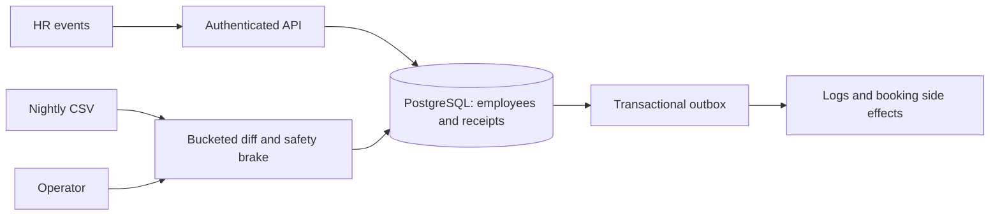

# HR Roster Sync — idempotent, out-of-order, self-healing

MoveInSync Backend Case Study 5 (Advanced Track). Java 21 · Spring Boot 4.1 · PostgreSQL 17 · one `docker compose up`.

> Status: **Live on AWS Sydney.** HTTPS, the light demo, reboot recovery and encrypted S3 backups are verified. The video recording and the local sub-second maximum-chunk target remain open.

## Target behavior

- Ingests employee **create / update / deactivate** events from HR in near real time, ignoring **stale** and **duplicate** ones, and rejecting invalid records **per record** without failing the batch.
- Protects **transport-owned fields** (pickup point, special assistance) from HR overwrites.
- Reconciles a **nightly 200,000-row export** with a bounded-memory bucketed diff and a **safety brake** that refuses to deactivate anyone when the file looks truncated.
- Publishes a change event for every applied change through a **transactional outbox**; deactivations cancel future cab bookings and free seats.

## Run it



```bash
cp .env.example .env
docker compose up --build
curl 127.0.0.1:8081/actuator/health/readiness
```
Requirements for the container run: Docker Desktop/Engine with Compose. No host Java or Maven is required. Run `./scripts/demo.sh` for the guided walkthrough, or `DEMO_AUTO=1 ./scripts/demo.sh` for assertions without pauses. Git Bash on Windows and Linux require curl + jq. The [Postman collection](postman/roster-sync.postman_collection.json) and [environment template](postman/roster-sync.postman_environment.json) contain the same requests; fill demoPassword locally.

On Windows PowerShell, use `Copy-Item .env.example .env` for the first step and `curl.exe` for the readiness request. The app starts after PostgreSQL is healthy; Flyway creates the schema. The API uses 8080; public Actuator endpoints use the separate management port, bound to `127.0.0.1:8081` on the host. PostgreSQL stays on the Compose network. The runtime is non-root and uploads live on the `/data` volume.

Local builds require JDK 21 or newer; JDK 22 is supported with `maven.compiler.release=21`. The Maven wrapper downloads Maven automatically:

```bash
./mvnw -B test               # unit tests, no Docker
./mvnw -B verify             # unit + PostgreSQL integration tests, Docker required
./mvnw -B verify -Pbenchmark # normal tests + separate 256 MiB benchmark forks
```

In PowerShell, replace `./mvnw` with `.\mvnw.cmd`. Docker and CI use Temurin 21. A network proxy, if required by your machine, belongs in your local Maven settings rather than the repository.

All Actuator endpoints are public on 8081; readiness includes database connectivity. No Actuator routes exist on 8080. POST `/api/v1/auth/token` is public; other API handlers require a signed bearer token and declare allowed roles. Both demo and production logging use ECS JSON; correlation IDs appear in `X-Correlation-Id` and error bodies, including 401/403 responses.

Optional monitoring: set a strong `GRAFANA_ADMIN_PASSWORD` in `.env`, then run `docker compose --profile monitoring up -d`. Prometheus is at `http://127.0.0.1:9090`; Grafana at `http://127.0.0.1:3000` (user `admin`), with the provisioned **Roster Sync Operations** dashboard. Default Compose starts only app and db. Metrics use finite labels without tenant/employee IDs or PII. `GET /api/v1/ops/summary` (OPERATOR) separates tenant-scoped durable SQL state from instance-wide counters/percentiles since restart; see [observability](docs/OBSERVABILITY.md). Production binds 8081 only to instance loopback for SSM forwarding; Caddy proxies only 8080, and Prometheus/Grafana stay local.

The `demo` profile seeds tenants `acme` and `globex`, offices `BLR-1`, `BLR-2`, inactive `BLR-3`, and `HYD-1`. Seeded usernames are `acme.hr`, `acme.admin`, `acme.operator`, `E1001`, `globex.hr`, `globex.admin` and `globex.operator`; their password comes from `DEMO_PASSWORD`. Acme has employees `E1001`–`E1005`, two future bookings and one completed booking for `E1002`, and route `R-BLR-07` with four seats. Restarting preserves existing data.

Compose defaults to `demo`. Ordinary production uses `prod` alone, without demo fixtures or dev endpoints. The interview deployment intentionally enables `prod,demo`; dev endpoints require OPERATOR authentication. Change all example credentials before exposing an interview deployment publicly.

Log in using the `DEMO_PASSWORD` chosen in `.env`, then pass the returned `accessToken`:

```bash
curl --fail-with-body localhost:8080/api/v1/auth/token \
  -H 'Content-Type: application/json' \
  -d '{"username":"acme.admin","password":"<your DEMO_PASSWORD>"}'
curl --fail-with-body localhost:8080/api/v1/offices \
  -H 'Authorization: Bearer <accessToken>'
```

Office reads allow TRANSPORT_ADMIN and OPERATOR; writes require TRANSPORT_ADMIN. Globex admins see their own offices, and accessing an Acme office returns 404. JWTs use HS256 with a secret of at least 32 UTF-8 bytes, expire after one hour by default, and allow 30 seconds of clock skew. Disabling a user prevents new tokens; existing tokens remain valid until expiry because validation is stateless. Details and response contracts are in [`docs/API.md`](docs/API.md) and [`docs/SECURITY.md`](docs/SECURITY.md).

## The rules, stated precisely

**Idempotency key:** `(tenantId, employeeId, version)`. **Version comparison** (per employee, under a row lock): newer version → `APPLIED` when content changes, `NO_CHANGE` when identical · older → `STALE` · equal → `DUPLICATE` if the payload hash matches, else `CONFLICT`. CREATE/UPDATE carry the **full HR-owned state** at that version, so their final state never depends on arrival order.

Higher-version identical snapshots, including DEACTIVATE on INACTIVE employees or tombstones, produce `VersionAdvanced` with outcome `NO_CHANGE`: advance the HR version/timestamp and write no outbox event. `Apply` requires non-empty changed fields and exactly one Employee outbox event. Equal versions with the same content remain `DUPLICATE`. The full rules are in `docs/API.md`.

**Field ownership conflict rule:** every field has exactly one owner (HR: name, email, phone, manager, office, shift, status; transport admin: pickup point, special assistance). HR payloads ignore non-owned fields with warning `FIELD_NOT_OWNED_BY_SOURCE`; transport PATCH rejects HR-owned keys with 400 and that code. Ownership is configuration (`roster.ownership.transport-owned`).

**Safety brake:** a nightly run that would deactivate ≥ 30 % of active employees (configurable, per tenant), exceeds the optional missing-count guard, or mismatches trailer/expected row counts stops in `AWAITING_APPROVAL` before any apply. Ratio comparisons use exact arithmetic; zero active employees skip ratio/count guards while row-count checks still apply. An operator may approve all, skip deactivations or reject.

## Documentation

| Doc | What's in it |
|---|---|
| [`docs/DESIGN.md`](docs/DESIGN.md) | design note: architecture diagram, hardest-flow sequence diagram, failure-mode table |
| [`docs/RECONCILIATION.md`](docs/RECONCILIATION.md) | bucketed diff, brake formula, complexity, where it stops scaling |
| [`docs/DECISIONS.md`](docs/DECISIONS.md) | trade-offs (consistency vs availability vs latency), what was left out |
| [`docs/DATA_MODEL.md`](docs/DATA_MODEL.md) · [`docs/API.md`](docs/API.md) | schema and API contract |
| [`docs/SECURITY.md`](docs/SECURITY.md) · [`docs/CACHING.md`](docs/CACHING.md) · [`docs/OBSERVABILITY.md`](docs/OBSERVABILITY.md) | auth/tenancy/PII/errors, caching staleness bounds, metrics |
| [`docs/TESTING.md`](docs/TESTING.md) | test catalogue, concurrency & failure-injection tests, benchmark method |
| [`docs/DEPLOYMENT.md`](docs/DEPLOYMENT.md) | compose, AWS options compared, EC2 runbook |
| [`docs/REQUIREMENTS_TRACEABILITY.md`](docs/REQUIREMENTS_TRACEABILITY.md) | every PDF requirement → code → test |

## Assumptions
1. Each employee's `version` is strictly increasing at the HR source (epoch millis if HR only has timestamps).
2. CREATE/UPDATE events carry the full HR-owned state; DEACTIVATE needs only id + version.
3. The nightly export carries each row's current version and the export's `asOf` time.
4. Employee IDs are unique per tenant, not globally.
5. Absence from the nightly file is weaker evidence than a versioned event, so recon deactivations never bump the HR version.
6. Operators are tenant-scoped users.

## Measured local performance

Machine: Intel Core i5-1240P, 12 physical / 16 logical cores, 15.69 GiB OS-reported RAM, Windows 11 Home Single Language build 26200. Docker Desktop Engine 29.9.2: 16 logical CPUs and 7.60 GiB VM memory. Host benchmark JDK 22.0.1 compiles release 21; the running app uses Temurin 21. These are local measurements, not AWS sizing guarantees.

The benchmark uses three runs in one dedicated 256 MiB JVM, a 200,000-employee source, deterministic seed 20261030, 1% mutation / 0.5% drop / 0.1% new. Each file has 199,190 valid rows and plans exactly 1,922 updates, 1,010 deactivations and 200 creates. Peak heap is sampled every 50 ms; coverage remains enabled for normal tests and is excluded from benchmark timing.

| Run | Dry-run wall time | Diff phase | Apply 3,132 actions | Sampled peak heap |
|---|---|---|---|---|
| 1 | 24.016 s | 23.794 s | 12.739 s | 104.83 MiB |
| 2 | 15.871 s | 15.732 s | 10.338 s | 111.57 MiB |
| 3 | 15.812 s | 15.738 s | 9.939 s | 111.77 MiB |
| **Median** | **15.871 s** | **15.738 s** | **10.338 s** | **111.57 MiB** |

At the candidate 40-action default, median mixed-file apply throughput is **303 actions/s**, and the largest chunk across the final three runs was **1,265 ms**. The throughput target is met, but the requested maximum below one second is **not yet met consistently**. An earlier three-sample run measured 304 actions/s and a 779 ms maximum; both sets are retained locally. Raw JSON is generated under target when the benchmark runs.

The matched update-only profiling comparison used 1,000 warm-up actions, 5,000 measured actions, chunk 64, the same 256 MiB heap and no coverage agent: **89.6 → 380.3 actions/s (4.25×)**. JDBC execution/batch/commit calls fell from **6.08 → 0.17 per action**. These counts describe JDBC calls, not packet captures. The implementation batches action status updates and outbox inserts, defers flushing, and reads/locks employee sets together.

Timings vary with startup and host load. Additional 40-action JDBC-counting probes measured 251–258 actions/s with 219–246 ms measured maxima and 0.833–1.605 s cold-start maxima; a stressed 64-action probe had a larger cold outlier. The final nightly-file repeat also exceeded one second, so performance acceptance remains open pending the agreed treatment of cold chunks and further tuning. See [trade-offs](docs/DECISIONS.md).

| k6 HTTP ingest | Duration | VUs | Batches/s | Events/s | HTTP p50 | HTTP p99 | HTTP / outcome failures |
|---|---|---|---|---|---|---|---|
| 50 events/batch, 90% fresh / 5% replay / 5% stale | 60 s | 20 | 8.46 | 423.00 | 2,210 ms | 3,912 ms | 0% / 0% |

The run completed 519 batches / 25,950 events. `./scripts/loadtest.sh` uses `BASE_URL=http://host.docker.internal:8080` on Windows Docker Desktop. Linux can also use `DOCKER_NETWORK=host BASE_URL=http://127.0.0.1:8080 ./scripts/loadtest.sh`. It writes the ignored loadtest/results/summary.json and exits non-zero if HTTP or outcome failures reach 1%.

## Complexity & limits _(summary; details in RECONCILIATION.md and DECISIONS.md)_
Event apply: O(log M) index lookup, O(1) memory. Reconciliation: O(N + M) time, O(N/B) heap with B = 256 buckets, O(N) temp disk. First scaling limits: single Postgres writer, single outbox poller, table growth, per-row apply for mass changes.

## Tests

| Type | Test cases |
|---|---|
| Unit and web-slice | 139 |
| jqwik properties | 2, each with 1,000 fixed-seed trials |
| Architecture and endpoint guards | 4 |
| PostgreSQL integration | 144 |
| Benchmark/profile methods | 2; the 200k method executes three samples |
| **Total including benchmark profile** | **291** |

The final unfiltered `./mvnw -B verify -Pbenchmark` passes all 291 tests with zero failures/errors/skips. Performance timings are measurements; the one-second chunk target remains open as stated above. Domain line coverage is **99.45% (359/361)**; JaCoCo renders its report at target/site/jacoco/index.html without a gate. Coverage includes ordering, idempotency, version-only updates, ownership, tenant/role isolation, rollback, real-context restart recovery, publisher concurrency, rehire, streaming/200k safety brake, management isolation, rollback-safe caches and PII boundaries. [Testing details](docs/TESTING.md).

## Demo video
[Demo video — recording pending](https://example.com/REPLACE_WITH_DEMO_VIDEO)

[Live API](https://rostersync-aditya.duckdns.org)

The video link is a placeholder. The API is live in **Sydney (`ap-southeast-2`)** at `rostersync-aditya.duckdns.org`. The repeatable local demo and sample requests are available now. [Deployment plan and private management access](docs/DEPLOYMENT.md).

## Local verification status

Verified on 2026-10-30 with Docker Desktop's Linux/WSL2 engine: clean-volume `docker compose up --build -d` succeeds. Readiness became UP in 33.36 seconds, and in 22.63 seconds after restarting the app. V1 defines 13 core tables; Phase 5 V2 adds processed_event alongside Flyway history; demo fixture counts are correct and unchanged after restart. All 30 captured application log lines were ECS JSON without fixture PII or sample secrets. Correlation headers and liveness pass. The container runs Temurin 21.0.13 as UID 10001 with writable `/data`.

Host Maven and Maven inside the build image reach Maven Central directly. The plain Docker build succeeds without HTTP_PROXY/HTTPS_PROXY build arguments, and Docker client automatic proxy defaults were unset. No proxy URLs, credentials, or network-specific defaults are committed. The temporary Maven settings used during initial setup remain outside the repository. First builds download images and dependencies; subsequent builds reuse the Maven build layers.

Domain line coverage is 99.45% (359/361 lines, no gate).

## Event ingestion and replay

```bash
curl --fail-with-body localhost:8080/api/v1/hr/events \
  -H 'Authorization: Bearer <HR_SYSTEM accessToken>' \
  -H 'Content-Type: application/json' --data-binary @samples/feed.json
```

The 50-event fixture creates/updates/deactivates/reactivates ten employees; its first send reports 44 APPLIED, 3 STALE and 3 in-batch DUPLICATE. Replaying it returns 50 DUPLICATE results, preserving employee row contents, receipts and outbox counts. Each duplicate includes originalOutcome. `samples/bad-batch.json` returns three APPLIED and two REJECTED results; rejected keys remain available for correction. Conflicts are audited with VERSION_CONFLICT and never keep a new receipt.

GET `/api/v1/employees`, `/employees/{id}`, `/employees/{id}/events` and `/me` enforce role, tenant and employee self-access. Lists return `{items,page,size,totalElements}` with size 1–200. PATCH `/employees/{id}/transport-fields` distinguishes null (clear) from absent (retain), supports inactive employees, and leaves versions/outbox untouched on a no-op. Only transport-owned fields are accepted.

HR batches contain 1–1000 records and at most 2 MiB (2,097,152 bytes). Both Content-Length and chunked bodies are bounded. Accepted event content is hashed with its type; eventId/occurredAt are excluded. Higher identical content advances the HR version/timestamp with NO_CHANGE and no Employee event. The Phase 5 publisher delivers committed outbox rows asynchronously, one transaction per row, with bounded sink execution, retries and consumer deduplication.


## Outbox crash and side effects
Run `./scripts/demo-crash.sh` from Linux or Git Bash on Windows (curl, jq and Docker CLI required). It arms a demo-only one-shot HALT, sends a unique employee event, shows the exit/restart and prints that eventId's published log line after readiness returns. Demo credentials come from the ignored .env or environment. Tokens and passwords are not printed.

Each publisher tick handles up to OUTBOX_BATCH_SIZE rows (default 100), each in its own transaction with FOR UPDATE SKIP LOCKED. Sink calls use four threads, queue 100 and OUTBOX_SINK_TIMEOUT (default 2s). A timeout does not cancel the sink: late completion and redelivery are possible. Consumers deduplicate `(sink,event_id)` and check current state. Retry delays start at 1s and double to 300s; OUTBOX_MAX_ATTEMPTS (default 10) ends in DEAD with one alert. OPERATOR can inspect tenant-scoped outbox/alerts and retry DEAD rows. Acknowledgement is idempotent. Delayed rows do not block newer events.

Deactivation cancels only future SCHEDULED bookings and frees seats, in an independent consumer transaction. The employee FOR UPDATE lock serializes the status check with rehire; booking creation uses FOR SHARE and rejects inactive employees. Retention runs in 5,000-row transactions at RETENTION_CRON. A single scheduler instance is assumed; multi-instance retention would need ShedLock. Graceful shutdown stops claims and allows 20 seconds per phase.

## Nightly reconciliation
POST multipart `/api/v1/reconciliation/runs` with file and asOf returns 202 after synchronous header validation. Parsing spills into 256 binary buckets; the pure differ compares one bucket at a time. The safety brake stops all changes when a truncated export appears to omit too many active employees. OPERATOR may approve ALL, approve SKIP_DEACTIVATIONS or reject; dry runs are terminal PLANNED runs. Whole-file ordering rejects asOf at/before the last completed export.

Explicit ADVANCE actions preserve higher identical versions without business events. Apply rechecks planned versions under employee locks, has no receipts or nested event retries, and commits configured chunks (default 40 after measured tuning). Each chunk batches employee flushing, outbox inserts and action-status bookkeeping. Failed chunks roll back before per-action fallback. Startup resumes APPLYING runs, fails interrupted planning and preserves awaiting approvals; a heartbeat watchdog avoids failing live work. Multi-instance deployment would need leases and shared upload storage.

Demo OPERATOR endpoints seed S000001… fixtures with Java CRC32/COPY and stream deterministic CSV exports with seed/mutation/drop/new/truncation options. Seed fixtures intentionally bypass outbox/receipts. Export uses a read-only PostgreSQL cursor with fetchSize=1000. See the run JSON contracts in [API.md](docs/API.md) and the algorithm in [RECONCILIATION.md](docs/RECONCILIATION.md).
