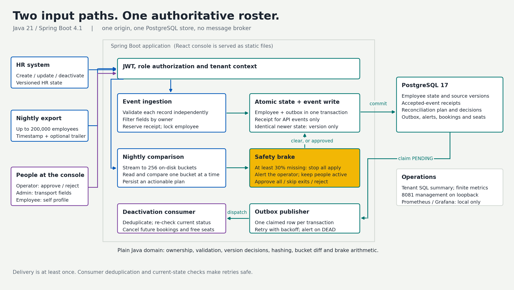

# Roster Sync

**Idempotent HR events. Ordered employee state. Safe nightly reconciliation.**

MoveInSync Case Study 5, Advanced Track. HR feeds can arrive twice, arrive late, contain bad records or stop halfway through. This service keeps the employee roster correct, preserves transport-owned fields and requires a human decision before an unsafe mass deactivation.

**[Open the live console](https://rostersync-aditya.duckdns.org)** | Credentials provided privately | [Demo video](#demo-video)

Java 21 · Spring Boot 4.1 · PostgreSQL 17 · React · Docker Compose

## Start your review here

| What to inspect | Where to go |
|---|---|
| Try the two examples from the brief | [Two-minute walkthrough](#two-minute-walkthrough) |
| Understand the design and its failure boundary | [Architecture](#architecture) and [two-page design note](docs/DESIGN.pdf) |
| Follow the presentation or review the interview evidence | [Presentation deck (PDF)](docs/roster-sync-deck.pdf) |
| Check each requirement against code and a test | [Requirements coverage](docs/REQUIREMENTS_TRACEABILITY.md) |
| Run the assignment on your machine | [Local setup](#local-setup) |
| Inspect measured results and their limits | [Performance](#performance) |
| Review security, operations and trade-offs | [Documentation map](#documentation-map) |

## Two-minute walkthrough

Open the live console and sign in with the password supplied privately. Each role has a different starting screen; server-side authorization enforces the same permissions.

| Demo user | Starting screen | Try this |
|---|---|---|
| `acme.hr` | Event console | Click **Out-of-order**: v5 applies, v7 applies, v6 is stale. Replay is a duplicate. |
| `acme.operator` | Operations | Inspect tenant counts, delivery failures and runs awaiting a decision. Open Runs to review a plan. |
| `acme.admin` | Employees | Find `E1001`; inspect HR/transport ownership, receipt history and bookings. Clear sends null; no-op Save is disabled. |
| `E1001` | My profile | View only this employee's profile and bookings. |

Reloading deliberately signs out: tokens exist only in memory. The interview deployment enables `prod,demo`; demo endpoints remain OPERATOR-only. The public image hides username hints and the development styleguide.

For the brief's **200k → 120k** example, use the local stack: operator → Demo tools → seed 200,000 once → generate a 120,000-row export → upload. The brake shows the actual missing count, applies nothing and waits for approval or rejection. The small AWS instance runs the light demonstration; the full dataset proof is local.

<details>
<summary>Verify the live API with five shell lines (Bash, curl and jq)</summary>

```bash
BASE=https://rostersync-aditya.duckdns.org; curl -sS -o /dev/null -w 'Console: %{http_code}\n' "$BASE/"
read -rsp 'Private demo password: ' DEMO_PASSWORD; echo
TOKEN=$(jq -n --arg password "$DEMO_PASSWORD" '{username:"acme.admin",password:$password}' | curl -fsS "$BASE/api/v1/auth/token" -H 'Content-Type: application/json' --data-binary @- | jq -er .accessToken)
curl -fsS "$BASE/api/v1/offices" -H "Authorization: Bearer $TOKEN" | jq
curl -sS -o /dev/null -w 'Without a token: %{http_code} (expected 401)\n' "$BASE/api/v1/offices"; unset DEMO_PASSWORD TOKEN
```

The [Postman collection](postman/roster-sync.postman_collection.json) and [environment template](postman/roster-sync.postman_environment.json) provide the same API flows. Fill the private password locally.

</details>

## Guarantees and proof

| Requirement | Implemented behavior | Automated evidence |
|---|---|---|
| Per-record validation | Malformed phone / unknown office rejects that row; the remaining batch continues | `BatchIsolationIT`, `RecordValidatorTest` |
| Ordering and replay | Employee versions never move backward; a second feed changes no employee, receipt or outbox state | `OutOfOrderIT`, `ReplayIdempotencyIT`, `ConcurrentEventsIT` |
| Field ownership | HR input cannot overwrite pickup point or special assistance | `FieldOwnershipIT`, `TransportFieldsIT` |
| Bounded nightly comparison | Stream and spill into 256 buckets; compare one bucket at a time | `ReconciliationBenchmarkIT` with `-Xmx256m` |
| Safety brake | Missing ratio **>= 30%** stops all apply, records an alert and waits for an operator | `SafetyBrakeTest`, `ReconciliationFlowIT.truncatedFileBriefExample` |
| Durable change events | Employee write and outbox insert commit together; publication can restart | `OutboxCrashRecoveryIT`, `OutboxRetryIT` |
| Deactivation effects | Cancel future scheduled bookings and free seats; delayed deactivation cannot cancel a rehire's bookings | `DeactivationIT` |
| Tenant and personal-data boundaries | Role check before resource lookup; tenant-scoped data; no PII in logs or errors | `AuthorizationIT`, `TenantIsolationIT`, `PiiLeakIT` |

Every requirement, including caching, metrics, OOP, concurrency and failure tests, is mapped in [the coverage matrix](docs/REQUIREMENTS_TRACEABILITY.md). **The demo video is the remaining submission artifact.**

## Architecture



The React console and REST API share one origin. A Java-only runtime serves the static build. The pure Java domain owns validation, ownership, version decisions, hashing and diff/brake logic; controllers remain thin. PostgreSQL stores both employee state and the durable outbox, so no broker is needed for this assignment.

The difficult failure is a consumer committing its work just before the publisher crashes. Delivery is **at least once**, so consumers deduplicate event IDs and check current employee state. [See the original recovery sequence and failure table](docs/DESIGN.md#hardest-flow-crash-after-delivery).

Diagram sources and SVG versions are in [docs/diagrams](docs/diagrams/); `render.py` uses Matplotlib. They describe this repository's implementation.

### See the console

These are real screens with synthetic demonstration data. The event console shows the server's decisions. Run review shows the safety brake before an operator decides whether to proceed.

| Send events and inspect each result | Review the nightly plan and safety brake |
|---|---|
| [](docs/images/console-events.png) | [](docs/images/console-run-review.png) |

Open either image for the full-size view. Also see the [operations board](docs/images/console-ops.png), [employee ownership drawer](docs/images/console-employee-detail.png) and [runs list](docs/images/console-runs.png).

## Local setup

**Required:** Docker Engine/Desktop with Compose. Host Java, Maven and Node are unnecessary for the container run.

```bash
cp .env.example .env
docker compose up --build
```

Open [localhost:8080](http://localhost:8080/). Local credentials come from your `.env`; public demo credentials are supplied privately. PostgreSQL starts first and Flyway applies migrations. No manual database setup is required.

| Local service | Address | Exposure |
|---|---|---|
| Console + API | `http://localhost:8080` | API requires bearer authentication |
| Readiness / metrics | `http://127.0.0.1:8081/actuator/health/readiness` | Host loopback only |
| PostgreSQL | Compose network | No published host port |

PowerShell: use `Copy-Item .env.example .env` and `curl.exe`. Shell scripts support Git Bash on Windows and Linux; install curl + jq for the scripted demos.

```bash
DEMO_AUTO=1 ./scripts/demo.sh          # complete local proof, including the 200k flows
./scripts/demo-crash.sh               # real HALT, restart and published event ID
```

Both scripts use unique IDs and the main demo handles prior active runs. Never use destructive volume cleanup on a dataset you want to retain. The [demo guide](docs/DEMO_SCRIPT.md) gives each expected result.

Optional local monitoring: set `GRAFANA_ADMIN_PASSWORD` in `.env`, then `docker compose --profile monitoring up -d`. Prometheus is on loopback port 9090; Grafana is on loopback port 3000 with the provisioned Roster Sync Operations dashboard. Default Compose starts only app + db. Monitoring services are not installed on the AWS instance.

## Event contract and assumptions

**Idempotency key:** `(tenantId, employeeId, version)`. `eventId` is informational. For an accepted receipt, compare SHA-256 of event type plus canonical, ownership-filtered HR fields; exclude `eventId` and `occurredAt`. Reusing its key with different type/content is `CONFLICT`; matching content is `DUPLICATE` with `originalOutcome`. Conflicts are audited without consuming a new receipt.

When no receipt matches, compare the incoming source version with the employee's current version:

| Incoming state | Outcome | Employee / outbox effect |
|---|---|---|
| Newer, HR-owned values changed | `APPLIED` | Update state and version; exactly one Employee outbox row |
| Newer, identical resolved HR state | `NO_CHANGE` | Advance version/timestamp; no business event |
| Older | `STALE` | Keep employee state and version |
| Equal, identical state | `DUPLICATE` | No employee change |
| Equal, different state | `CONFLICT` | No employee/outbox write; safe rejection audit |

CREATE and UPDATE are **full HR snapshots**, not patches. Timestamp-only sources must send an increasing epoch-millisecond version. This is why v7 remains correct even if v6 arrives afterward. An unknown DEACTIVATE creates an inactive tombstone; later lower versions cannot resurrect it.

**Ownership conflict rule:** HR owns name, email, phone, manager, office, shift and status. Transport owns pickup point and special assistance. HR input for transport fields is ignored with `FIELD_NOT_OWNED_BY_SOURCE`; transport PATCH rejects HR keys. Explicit null clears a transport field; an absent key leaves it unchanged. All validation errors are field/code pairs, not rejected values.

The configurable brake trips at **ratio >= threshold**, on the optional missing-count guard, or on trailer/expected row-count mismatch. Zero active employees skip ratio/count checks only. A tripped run applies **nothing** until an OPERATOR approves all, approves without deactivations, or rejects it. Snapshot comparison also heals equal-version drift and advances higher identical versions. [Full API contract](docs/API.md).

Assumptions: one application instance/poller, one PostgreSQL primary, full-state HR events, and 256 fixed hash buckets. Settings apply to the next run. Caffeine caches are per JVM: offices 10 minutes, employee reads 30 seconds, bounded size and after-commit eviction; in-transaction office validation bypasses cache. See [cache bounds](docs/CACHING.md).

## Performance

Local machine: **Intel Core i5-1240P**, 12 physical / 16 logical cores, **15.69 GiB RAM**, Windows 11 build 26200. Docker Desktop Engine 29.9.2 uses 16 logical CPUs and **7.60 GiB** VM memory. Host JDK 22.0.1 compiles release 21; Docker uses Temurin 21. Results below are local measurements, not AWS latency guarantees.

| Workload | Measured result |
|---|---|
| Exact 200,000-row snapshot; 256 MiB heap | **16.571 s** dry-run wall time; **104.84 MiB** sampled peak heap |
| Mixed export against 200,000 employees; median of 3 runs | **13.306 s** dry-run wall time; **120.14 MiB** sampled peak heap |
| Reconciliation apply, default chunk 40 | **313.5 actions/s** in the final recheck; prior repeats 296.5–304, so a 300/s floor is not consistent |
| Committed chunks, including cold work | p50 **120.9 ms**, p99 **301.2 ms**, max **1,174.4 ms** |
| Single-event HTTP, 5 VUs / 60 s | **59.0 events/s**; p50 **71.18 ms**, p99 **235.36 ms** |

Final audit: 2026-10-31. The mixed file contains 199,190 rows after controlled drops/new rows; the exact-size case runs before the mixed samples in the same fork, so their comparison path is warmed. This is a recheck, not a claimed code optimization. The separate k6 measurements below are the 2026-10-30 baseline. The exact 200,000-row final-audit case is reported in [performance evidence](docs/PERFORMANCE.md). Chunk acceptance is p99 <1 s **and** max <2.5 s, including commit and cold work; it passes with chunk 40.

Batch-size-50 scaling, with synchronous commit **on**:

| VUs | Events/s | Request p50 / p99 (ms) | Per-event p50 / p99 (ms) | Max Hikari pending | PG commits/s |
|---|---:|---:|---:|---:|---:|
| 1 | 75.9 | 650.6 / 933.1 | 13.01 / 18.66 | 0 | 96.2 |
| 5 | 245.1 | 985.6 / 1,380.6 | 19.71 / 27.61 | 0 | 243.4 |
| 10 | 322.1 | 1,446.4 / 2,502.7 | 28.93 / 50.05 | 0 | 301.2 |
| 20 | 405.0 | 2,325.4 / 3,832.8 | 46.51 / 76.66 | 1 | 372.9 |

Per-event batch figures are **request duration / 50**, an amortized cost rather than an individual response latency. PG commits/s uses `xact_commit` delta over the enclosing measured wall window, including publisher/observer work.

1. Scaling bends above 5–10 VUs: doubling 10 to 20 VUs adds 26% throughput while request p99 rises 53%.
2. A diagnostic `synchronous_commit=off` run reached 492 events/s (+21.5%), showing durable commit I/O contributes; the setting was restored to **on**. This is not the production configuration.
3. Pool pending remained near zero, so the pool stays at 20. The outbox backlog reached 22,260 rows: 405 events/s is an ingress burst rate, not sustained end-to-end delivery capacity.

Event application uses O(log M) indexed lookup and O(1) working state. Bucketed comparison is O(N + M) time and expected O((N + M)/256) working heap, plus O(N) spill disk; skew can increase the largest bucket. Mass-change apply is bounded by writes/outbox work, and multiple instances would need leases and shared upload storage. [All samples, before/after profiling and cold-JIT variation](docs/PERFORMANCE.md).

## Tests and failure proof

```bash
./mvnw -B verify                 # JDK 21+, Docker; unit, property, guard and PostgreSQL integration tests
./mvnw -B verify -Pbenchmark     # also constrained-heap benchmarks; manual/weekly CI only
cd frontend
npm ci                          # Node 24 LTS, frontend checks only
npm run lint && npm run lint:design && npm run typecheck && npm test && npm run build
```

On PowerShell use `.\mvnw.cmd`. Docker/CI use Temurin 21. Maven verification works without Node.

| Evidence | Latest verified count |
|---|---:|
| Backend unit/web/property/architecture guards | 145 (including two fixed-seed properties with 1,000 tries each) |
| PostgreSQL integration | 147 |
| Normal backend verification | **292 passed** |
| Frontend unit | **26 passed** |
| Real-Compose browser cases | **15 passed**, including **48** axe scans with zero serious/critical findings |
| Authenticated Lighthouse accessibility | **100/100** on Runs and Employees, light/dark |

The production initial JS is 109.46 kB gzip. Browser checks cover role menus, memory-only login, transport null/no-op behavior, all six event presets, safe errors and the real brake/rejection workflow. [Reproducible commands and complete test catalogue](docs/TESTING.md).

The crash tests cover failure before commit, after commit before publication, and after a consumer commit before publication acknowledgement. Outbox delivery is at least once: a timeout does not stop a sink, so consumers deduplicate and re-check employee status. Lock retries occur outside record transactions; failed reconciliation chunks roll back before fallback. [Failure table and recovery sequence](docs/DESIGN.md#hardest-flow-crash-after-delivery).

## Deployment and trade-offs

The live console runs on an existing **t4g.small in Sydney (`ap-southeast-2`)** with app + PostgreSQL + Caddy. About 150 ms added latency from India is accepted. Only 80/443 are public; HTTPS redirects are enforced. Management 8081 binds to instance loopback and is available through SSM; 22, 5432, 8080 and 8081 are closed externally. No demo password is committed, logged or printed here.

The deployment uses a 2 GB swap file, JVM `-Xmx768m`, PostgreSQL `shared_buffers=256MB`, Docker log rotation and encrypted S3 backups. [Deployment, private credential retrieval and management access](docs/DEPLOYMENT.md) · [Stop/start and teardown](deploy/aws-ec2/TEARDOWN.md).

Trade-offs: PostgreSQL consistency over accepting writes during a DB outage; per-record transactions over maximum batch throughput; at-least-once delivery with consumer dedupe over a false exactly-once execution claim; local Caffeine over an extra Redis dependency. Deliberately omitted: a broker, Kubernetes, multi-instance worker leases, a full transport product and in-flight run cancellation. Existing JWTs remain valid until expiry after account disablement; an IdP/revocation mechanism is a production extension. [Decision records](docs/DECISIONS.md).

## Documentation map

| Question | Document |
|---|---|
| How does the system work, and recover? | [Two-page PDF](docs/DESIGN.pdf) and [Markdown](docs/DESIGN.md) |
| How can I follow the demo and inspect the design decisions? | [Presentation deck, slides only](docs/roster-sync-deck.pdf) |
| What does each endpoint accept and return? | [API](docs/API.md) |
| Which requirement is proved by which test? | [Requirements coverage](docs/REQUIREMENTS_TRACEABILITY.md) |
| How are snapshots partitioned, compared and applied? | [Reconciliation](docs/RECONCILIATION.md) |
| Where do state, receipts and events live? | [Data model](docs/DATA_MODEL.md) |
| Why these trade-offs? | [Decisions](docs/DECISIONS.md) |
| What are the auth, tenancy and privacy boundaries? | [Security](docs/SECURITY.md) |
| What can be stale, and for how long? | [Caching](docs/CACHING.md) |
| Which metrics, logs, alerts and operational views exist? | [Observability](docs/OBSERVABILITY.md) |
| How were the numbers measured? | [Performance](docs/PERFORMANCE.md) and [testing](docs/TESTING.md) |
| How do I replay the demonstration? | [Demo script](docs/DEMO_SCRIPT.md) |
| How is the console designed? | [Frontend](docs/FRONTEND.md) |

Code: `api → application → domain`; infrastructure supplies persistence, security, caching and metrics. `domain` has no Spring/Jakarta/SQL/application/API dependency; architecture tests enforce it. The `frontend/` build is embedded in the Java jar. `samples/`, `postman/`, `loadtest/`, `ops/` and `deploy/aws-ec2/` contain the reproducible supporting tools.

## Demo video

**Demo video link: pending recording.** The recording will show ordering/replay, the truncated-file brake, a real crash/recovery and sample API calls. The [presentation deck](docs/roster-sync-deck.pdf) accompanies those flows. The live assignment and automated demonstrations are ready.

<!-- DEMO_VIDEO_URL: add the final recording link here. -->
