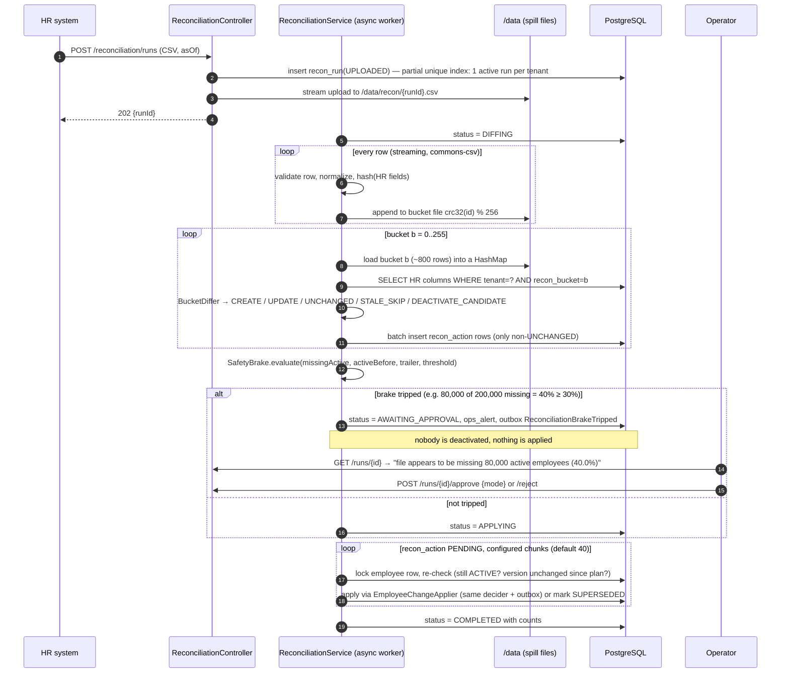

# HR Roster Sync — Design Note

> MoveInSync Backend Case Study 5 · Advanced Track.
> This is the "one or two pages" design note the brief asks for: architecture diagram, one sequence diagram for the hardest flow, and a failure-mode table. Deeper detail lives in the other files in `docs/`.

## 1. Problem in one paragraph

Corporate HR systems push employee changes (create / update / deactivate) to us in near real time, and once a night send a full export of up to 200,000 employees as a file. Feeds arrive **twice**, **out of order**, with **bad records**, and the file is sometimes **cut short**. Some fields belong to HR, some to the transport admin. The service must keep the employee roster correct anyway, tell downstream systems about every change reliably, and cancel cab bookings and free seats for people who leave.

## 2. Core ideas (the five things to remember)

| # | Idea | One-line justification |
|---|------|------------------------|
| 1 | **Events are full-state snapshots of HR-owned fields, ordered by a per-employee `version`** | Because each event carries the whole HR state, "highest version wins" is correct and arrival order stops mattering. Stale = ignore, equal = duplicate check. |
| 2 | **Idempotency key = `(tenantId, employeeId, version)`** stored in `hr_event_receipt` | A replayed event hits the unique key and becomes a no-op that returns the same outcome. Same key + different payload = `CONFLICT`. |
| 3 | **Field ownership is a policy, not code** (`FieldOwnershipPolicy`, configured in `application.yml`) | HR writes only HR-owned fields; transport fields in an HR payload are dropped with a warning. Moving a field between owners is a config change. |
| 4 | **Nightly reconciliation = Grace-hash-style bucketed diff + safety brake** | Stream the file once into 256 hash buckets on disk, then compare one bucket at a time with the DB. Memory is O(N/B). If ≥30 % of active employees are missing, quarantine the run until an operator approves. |
| 5 | **Transactional outbox** | The employee row and its change event are written in the **same DB transaction**; a poller publishes later with at-least-once delivery. They can never disagree. |

## 3. Architecture

```mermaid
flowchart LR
  subgraph Clients
    HR[HR system<br/>role HR_SYSTEM]
    ADM[Transport admin<br/>role TRANSPORT_ADMIN]
    OPS[On-call operator<br/>role OPERATOR]
    EMP[Employee<br/>role EMPLOYEE]
  end

  subgraph App["roster-sync (Spring Boot 4.1, Java 21) — one container"]
    SEC[JWT filter + TenantContext]
    API[REST controllers<br/>/hr/events · /employees · /reconciliation · /ops]
    ING[EventIngestionService]
    APPLY[EmployeeChangeApplier<br/>@Transactional per record]
    CORE[[Domain core — plain Java<br/>RecordValidator · ChangeDecider<br/>FieldOwnershipPolicy · RecordHasher<br/>BucketDiffer · SafetyBrake]]
    RECON[ReconciliationService<br/>upload → diff → brake → apply]
    PUB[OutboxPublisher<br/>@Scheduled, SKIP LOCKED]
    SINKS[EventSinks<br/>LogEventSink · DeactivationSideEffectHandler]
    CACHE[(Caffeine caches<br/>offices · employee reads)]
    MET[Micrometer metrics<br/>+ structured JSON logs]
  end

  PG[(PostgreSQL 17<br/>employee · hr_event_receipt · outbox_event<br/>recon_run · recon_action · cab_booking · route_seat)]
  DISK[(/data volume<br/>uploaded files + bucket spill files)]

  HR -->|POST /hr/events| SEC
  HR -->|POST /reconciliation/runs (CSV)| SEC
  ADM --> SEC
  OPS --> SEC
  EMP --> SEC
  SEC --> API
  API --> ING --> APPLY
  API --> RECON
  APPLY --> CORE
  RECON --> CORE
  RECON --> APPLY
  RECON --> DISK
  APPLY -->|employee row + outbox row<br/>same transaction| PG
  PUB -->|poll PENDING| PG
  PUB --> SINKS
  SINKS -->|cancel bookings, free seats| PG
  API --> CACHE
  App -.-> MET
```

**Why one service + Postgres and no broker:** the brief asks for a one-command run, and every guarantee we need (atomicity of state + event, per-employee serialization, durable queue) is available inside one Postgres transaction. The `EventSink` interface is the seam where Kafka/RabbitMQ would plug in. See `DECISIONS.md` ADR-003.

### Layering (enforced by package structure)

```
com.moveinsync.rostersync
├── api            controllers, request/response DTOs, GlobalExceptionHandler   (web only)
├── application    services: ingestion, applier, transport profile, reconciliation, outbox publisher, side effects
├── domain         PURE Java, no Spring imports: model, ownership, validation, decision, hashing, recon diff, brake
├── infrastructure persistence (JPA entities, repositories, JDBC DAOs), csv, security, cache, metrics, fault injection
└── config         Spring configuration + @ConfigurationProperties
```

Rule: `domain` must not import `org.springframework.*` or `jakarta.persistence.*`. A test (`ArchitectureTest`) checks this.

## 4. Data model (summary — full DDL in `DATA_MODEL.md`)

- `employee` — one row per `(tenant_id, external_id)`. HR columns (`name, email, phone, manager_external_id, office_id, shift_code, status`), `hr_version`, `hr_updated_at`; transport columns (`pickup_point, special_assistance`), `transport_version`; `recon_bucket` (CRC32(employeeId) mod 256).
- `hr_event_receipt` — idempotency ledger, `UNIQUE(tenant_id, external_id, version)`, stores payload hash + outcome.
- `outbox_event` — `PENDING → PUBLISHED | DEAD`, attempts, `next_attempt_at`.
- `recon_run`, `recon_action` — the nightly run's state machine and its planned actions.
- `record_rejection` — per-record validation failures (IDs and error codes only, no PII).
- `cab_booking`, `route_seat` — minimal transport domain for deactivation side effects.
- `tenant`, `tenant_settings`, `office`, `app_user`, `ops_alert`.

## 5. Main flows

### 5.1 Real-time event (per record, one transaction each)

1. **Validate at the boundary** (`RecordValidator`, pure): phone E.164, email format, office code exists for this tenant, required fields, `version > 0`. Invalid → `REJECTED` with `[{field, code}]`; written to `record_rejection`; the rest of the batch continues. Rejected events do **not** consume their idempotency key, so HR can resend a fixed record with the same version.
2. **Receipt**: `INSERT INTO hr_event_receipt ... ON CONFLICT DO NOTHING`. If the key already exists → compare payload hash → `DUPLICATE` (same) or `CONFLICT` (different). Done, no state change.
3. **Lock the employee**: `SELECT ... FOR UPDATE`. If absent, insert; if the insert loses a race (unique violation) the applier retries the transaction once and finds the row.
4. **Decide** (`ChangeDecider`, pure): newer version with different resolved HR hash → `Apply`; newer with the same hash → `VersionAdvanced(newVersion)` / `NO_CHANGE`; older → `STALE`; equal → `DUPLICATE` if hashes match else `CONFLICT`. Ownership policy filters HR-owned fields and warns about transport-owned input.
5. **Write**: `Apply` requires non-empty changed fields and atomically updates employee state/version plus exactly one Employee outbox row. `VersionAdvanced` updates only `hr_version` and `hr_updated_at`, writes receipt outcome `NO_CHANGE`, and emits no outbox event. The high-water version always equals the maximum valid version seen. Phase 4 proves `Employee* outbox rows == APPLIED count`.
6. **After commit**: evict the employee read cache entry; increment metrics.

### 5.2 Nightly reconciliation (the hardest flow)



The domain decision core is pure Java. Higher-version identical snapshots advance the source version through the distinct `VersionAdvanced` decision without a business event. This also applies to repeated deactivation of tombstones: v5 → DEACTIVATE v8 retains v8, CREATE v6 is stale, and CREATE v9 emits EmployeeCreated. Equal-version file drift is a heal; equal-version event drift is a conflict.

Details, edge cases, complexity and the brake formula are in `RECONCILIATION.md`.

### 5.3 Outbox publish + deactivation side effects

`OutboxPublisher` runs every 500 ms and processes at most 100 rows per tick. Each row has its own short transaction: `WHERE status='PENDING' AND next_attempt_at <= :now ORDER BY id LIMIT 1 FOR UPDATE SKIP LOCKED`, dispatch that event, then mark PUBLISHED and commit. No batch transaction holds locks across different events. No due row ends the tick. Failures increment attempts and schedule `min(2^(attempts-1) seconds, 300 seconds)`; ten failures mark DEAD and create one OUTBOX_EVENT_DEAD alert for the event. Clock supplies all runtime timestamps. Manual retry is tenant-scoped and only accepts DEAD rows, resetting attempts to zero.

Sinks run on four threads with a bounded queue of 100 and `CompletableFuture.orTimeout` (two seconds). Queue rejection counts as failure. A timeout does not stop the sink: it may commit later, followed by redelivery. A single production poller uses id order among ready rows; delayed retries do not block later ids, so consumers must check current state/version. Delivery is **at-least-once**. Graceful shutdown stops claims, lets the current row complete or roll back, and allows 20 seconds per shutdown phase.

`DeactivationSideEffectHandler` handles `EmployeeDeactivated` in REQUIRES_NEW, independent of the publisher's transaction. It inserts `(sink,event_id)` into processed_event first; an existing key returns immediately. It locks the employee FOR UPDATE, skips if ACTIVE again (reason=reactivated), otherwise cancels SCHEDULED bookings strictly after Clock.now and frees seats. The consumer commit can survive a publisher rollback; redelivery hits the dedupe key. Booking creation locks the employee FOR SHARE and rejects INACTIVE with EMPLOYEE_INACTIVE. These employee locks close the rehire/new-booking race. The handler does not require a version bump, so reconciliation uses the same event type.

Retention uses separate transactions of at most 5,000 rows, looped for receipts (30 days), published outbox (7 days) and processed_event (7 days). Its cron is configurable. The deployment assumes a single scheduler instance; multiple instances would need ShedLock or equivalent leader coordination.

## 6. Failure-mode table

| # | What fails | What the user / caller sees | How the system recovers |
|---|-----------|------------------------------|--------------------------|
| 1 | HR retries a batch (duplicate) | Per record `DUPLICATE`, HTTP 200 | Receipt unique key → no-op; no new outbox rows |
| 2 | v7 arrives before v6 | v7 `APPLIED`, later v6 `STALE` | Version comparison under row lock; final state = v7 |
| 3 | Same version, different payload | `CONFLICT` for that record | Not applied; `roster_events_total{outcome=conflict}` + WARN log with IDs only |
| 4 | Malformed phone / unknown office | `REJECTED` with `[{field, code}]`; other records proceed | Stored in `record_rejection`; key not consumed, HR can resend fixed record |
| 5 | App crashes **after commit, before publish** | Caller already got `APPLIED` | Outbox row stays `PENDING`; publisher sends it after restart (crash test proves it) |
| 6 | App crashes mid-transaction | Caller gets 5xx / connection reset | Postgres rolls back employee + outbox + receipt together; HR's retry is idempotent |
| 7 | Crash after sink succeeded, before row marked `PUBLISHED` | Nothing visible | Event re-sent; sinks are idempotent; consumers dedupe on `eventId` |
| 8 | Sink down / times out | `outbox_pending` and `outbox_oldest_pending_age_seconds` grow | Exponential backoff retries; `DEAD` after 10 + `ops_alert`; `POST /ops/outbox/{id}/retry` |
| 9 | Postgres down | 503 on writes, `/actuator/health/readiness` DOWN | Fail closed; nothing partially written; HR retries later |
| 10 | Two events for the same employee concurrently | Both get a correct outcome | `SELECT ... FOR UPDATE` serializes; concurrency test |
| 11 | Two concurrent creates of a new employee | One `APPLIED`, other `APPLIED`/`STALE` by version | Unique `(tenant, external_id)` + one retry of the losing transaction |
| 12 | Lock wait exceeds `lock_timeout` (5 s) | Record outcome `RETRYABLE_ERROR` | Applier retries up to 3×; else reported, HR resends |
| 13 | Nightly file truncated (120k of 200k) | Run `AWAITING_APPROVAL`, message with missing count and % | Brake: nobody deactivated, nothing applied, `ops_alert` + metric; operator approves/rejects |
| 14 | File has wrong header / is empty / trailer count mismatch | Run `FAILED` (header/empty) or brake forced (trailer mismatch) | No changes applied; operator re-uploads |
| 15 | Bad rows inside an otherwise good file | Run completes; `rowsRejected` + `/runs/{id}/rejections` | Invalid rows with a valid ID count as **present** (never cause deactivation) |
| 16 | Crash during diff | Run later shows `FAILED (interrupted)` | Startup recovery marks it failed; re-upload is safe (diff has no side effects) |
| 17 | Crash during apply | Run resumes as `APPLYING` after restart | Startup recovery resumes `PENDING` actions; each action re-checks under lock (idempotent) |
| 18 | Real-time event lands while a run is applying | Event applied normally | Each recon action re-checks version/status; stale plan → `SUPERSEDED` |
| 19 | Second upload while a run is active | 409 `RECON_RUN_ALREADY_ACTIVE` | Partial unique index on `recon_run(tenant_id)` for non-terminal statuses |
| 20 | Deactivated employee re-hired before side effect ran | Bookings stay intact | Handler re-reads status and skips |
| 21 | Stale office cache on another node | New office briefly `UNKNOWN_OFFICE` (≤ 10 min) | FK `employee.office_id → office.id` guarantees integrity; local eviction on change |
| 22 | Token of tenant A used for tenant B's employee | 404 `NOT_FOUND` (no existence leak) | Tenant always taken from the token; every query filters by `tenant_id` |

## 7. Guarantees and how each is proven

See `REQUIREMENTS_TRACEABILITY.md` — every hard rule maps to an automated test, including at least one concurrency test (`ConcurrentEventsIT`) and one failure-injection test (`OutboxCrashRecoveryIT`).

## 8. What is deliberately left out

Kafka/RabbitMQ (seam: `EventSink`), CDC/Debezium, Redis (seam: Spring Cache), multi-instance scheduler locking (ShedLock), Postgres row-level security, SFTP ingestion, an identity provider (we mint our own JWTs), PII encryption at rest, a UI. Reasons in `DECISIONS.md`.

Phase 4 receipt refinement: reserve the key using INSERT ON CONFLICT DO NOTHING with provisional PROCESSING, then lock/decide/write and finalize the receipt in the same transaction. A concurrent same-key insert waits for the first transaction: commit yields a conflict on insertion, rollback lets the waiting insert succeed. Replays return DUPLICATE plus the stored originalOutcome. CONFLICT never reserves content: roll back a newly inserted provisional receipt, leave existing receipts untouched, and audit VERSION_CONFLICT in a separate transaction. REJECTED keys are likewise unconsumed.

Phase 6 implementation details: upload uses transferTo and first-line header validation before run insertion. Whole-file asOf ordering rejects exports at/before the last COMPLETED run; acceptance and completion share a brief tenant lock. The streaming parser strips BOM, recognizes only a final trailer and spills length-prefixed binary records. Per-bucket duplicate handling chooses the highest version and treats equal-version conflicting content as present-but-invalid. Bucket queries include inactive rows/tombstones. Planning has separate ADVANCE counts and short per-bucket progress transactions. Each apply chunk rechecks the expected employee version and uses the shared snapshot path without receipts or nested retries. The measured default is 25 actions after an initial 500-action chunk exceeded lock_timeout. Failed chunks roll back before per-action fallback and safe rejection auditing. Startup/watchdog recovery uses heartbeat_at and a single-instance worker ownership assumption.

## Phase 8 measured apply path

The current default is 40 actions per transaction. Employee rows are selected/locked as a tenant-scoped set in stable ID order; relevant offices use plain READ COMMITTED reads. One employee flush, a JDBC outbox batch and one action-status UPDATE using id=ANY arrays replace per-action bookkeeping. Expected versions are checked under those locks, and a failed chunk rolls back before fallback. API receipt transactions remain per-record. Three 256 MiB benchmark samples give a final median 15.871s dry-run wall time, 10.338s apply for 3,132 actions and 111.57 MiB sampled peak heap; maximum observed mixed-file chunk is 1,265ms. This repeat exceeds the requested one-second maximum, so performance acceptance remains open. An earlier three-sample set measured 779ms; the latest result is reported here. The README includes instrumented/cold timing variation and the machine specification. Cancellation of in-flight runs is omitted: it needs cooperative chunk boundaries and a defined CANCELLED state.
