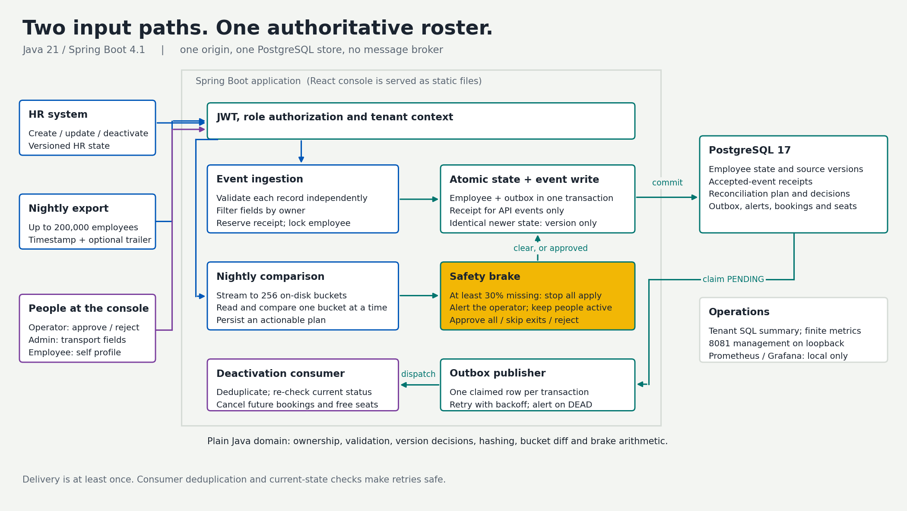
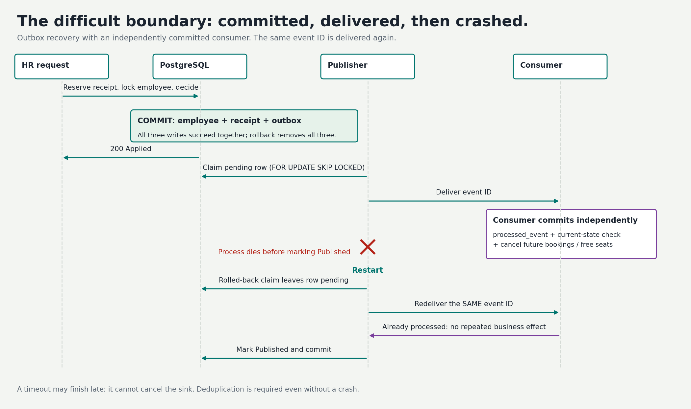

# Design note: HR Roster Sync

[Print-ready two-page PDF](DESIGN.pdf). Case Study 5 / Advanced Track. Two input paths keep one authoritative employee roster correct despite duplicates, stale events, invalid rows and incomplete exports.

## Architecture

**Boundary:** controllers authenticate/authorize and call application services. The pure Java domain validates, filters ownership, hashes canonical state and decides versions/diff/brake outcomes. JPA handles entities; JDBC handles receipt reservation, bulk plans and outbox JSON. PostgreSQL is the transactional authority. Node builds the React console; only Java runs the app. No broker is required.

**Data:** employee is unique on `(tenant_id, external_id)`; receipt on `(tenant_id, external_id, version)`. The outbox shares the employee transaction. Run/actions persist the nightly plan and human decision. Rejections/alerts contain identifiers and codes only. See [schema](DATA_MODEL.md) and [API](API.md).

**Two paths:** API records each get a separate transaction: validate, reserve receipt, lock employee, decide, write/finalize. Same-key insertion waits for a concurrent transaction to commit or roll back. Conflicts roll back their provisional receipt and audit separately. A newer identical state advances the version without an Employee event. Snapshot files stream into 256 disk buckets; each bucket is compared independently. A tripped brake stops all application until approval. Apply uses 40-action chunks, locks only the relevant employee rows and re-checks versions before batched writes. Reconciliation creates no event receipts.

## Hardest flow: crash after delivery

Delivery is at least once. Each publisher transaction claims one pending row with `FOR UPDATE SKIP LOCKED`, dispatches with a timeout, then marks published. A consumer's `REQUIRES_NEW` commit survives publisher rollback. `processed_event(sink,event_id)` deduplicates redelivery; an employee row lock and current status check prevent a delayed deactivation from cancelling a rehire's bookings. A timeout does not cancel an already running sink.

## Failure modes

| What fails | What the caller/operator sees | Recovery |
|---|---|---|
| Invalid record | Field/code rejection; rest of batch continues | Correct and resend; rejected key remains free |
| Duplicate / late event | DUPLICATE / STALE, no employee mutation | Durable receipt and source version prevent regression |
| Truncated nightly file | Missing count and approval brake; no apply | Approve all, skip deactivations, or reject |
| Process before DB commit | No partial employee/event/receipt | Transaction rollback; retry safely |
| Process after commit / consumer delivery | Pending outbox and possible redelivery | Restart publisher; consumer dedupe/current-state check |
| Sink failure / timeout | Backoff, then DEAD with one alert | OPERATOR retries; later queue rows can proceed |
| Interrupted comparison / apply | FAILED comparison / durable pending actions | Re-upload comparison; restart resumes apply |
| Database unavailable | Safe dependency error, no speculative state change | Fail closed until DB recovers |

## Bounds and trade-offs

Comparison is O(N + M) time, expected O((N + M)/256) heap and O(N) spill disk; the largest skewed bucket sets the actual heap bound. One primary and one worker/poller simplify consistency, at the cost of availability and mass-update throughput. Multiple instances need durable leases, shared uploads and cross-instance invalidation. Caffeine bounds office/employee staleness to 10 min / 30 s with after-commit eviction; transactional office checks bypass it. JWT validation is stateless; disabled users' issued tokens last until expiry. See [performance](PERFORMANCE.md), [decisions](DECISIONS.md), [security](SECURITY.md), and [requirement-to-test coverage](REQUIREMENTS_TRACEABILITY.md).
