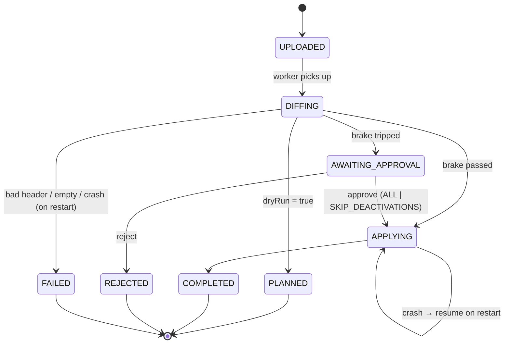

# Nightly Reconciliation — Algorithm, Safety Brake, Complexity

## 1. Goal

Compare tonight's full HR export (≤ 200,000 rows) with our store, **without loading both fully into memory**, in **< 60 s**, and:
- create employees we've never seen (missed CREATE events),
- update employees whose HR state is newer in the file (missed UPDATE events),
- heal records whose content drifted at the same version,
- deactivate active employees who are absent from the file —
- **unless** the file looks broken, in which case stop, alert, and deactivate nobody until a human approves.

This is the "self-healing" part of the title: the real-time feed is fast but lossy; the nightly snapshot is slow but authoritative, and it repairs whatever the feed missed.

## 2. Why bucketed hashing (and not the alternatives)

| Option | Memory | Why not / why |
|---|---|---|
| Load file into a `HashMap`, load DB into a `HashMap`, compare | O(N) both sides (~100–200 MB for 200k rows of objects) | Violates "without loading both fully into memory". |
| Load only `id → hash` of the file into memory, stream DB | O(N) but small (~20–30 MB) | Works, but still grows linearly with tenant size; not "bounded". Good fallback to mention. |
| External sort both sides by id, merge-join | O(1) + disk | Correct, but sorting 200k rows on disk is more code than needed. |
| Staging table + SQL `FULL OUTER JOIN` | O(1) app memory | Very fast, but the core logic lives in SQL — the brief asks for the core algorithm in **plain testable classes**. Mention as the production optimization. |
| **Grace-hash partitioning: spill file into B hash buckets on disk, then diff one bucket at a time against the DB rows of that bucket** | **O(N/B)** heap + O(N) temp disk | Bounded memory you can tune with B; the per-bucket diff is a pure function (`BucketDiffer`) testable without a DB; each DB query is a small indexed range. **Chosen.** |

This is the classic Grace hash join (partition both inputs by a hash of the join key so each partition fits in memory) applied to a diff; the DB side is already "partitioned" because we store `recon_bucket` with an index. The idea of comparing hashes per range/bucket is the same idea Dynamo-style anti-entropy uses with Merkle trees; we stop at one level of buckets because 200k rows don't need more.

## 3. The algorithm

```
B = 256                                     // roster.reconciliation.buckets (fixed; changing it needs a re-bucket migration)
bucket(id) = CRC32(utf8(id)) mod B          // java.util.zip.CRC32: stable across JVMs, uniform enough

PASS 1  — stream the file once (commons-csv, never materialize the whole file)
  for each row r (line number n):
     if r is the trailer line: remember trailer count; continue
     v = RecordValidator.validateFileRow(r, officeLookup)
     if v has errors:
         record_rejection(n, r.employeeId?, codes)
         if r.employeeId is syntactically valid: mark "present-but-invalid" (it still counts as present → never deactivated)
         continue
     snapshot = normalize(r);  h = RecordHasher.hash(snapshot)
     append binary record (row number, id, version, validity, hash, fields) to bucket(id)
     // DataOutputStream, length-prefixed UTF-8, -1 null marker; 256 x 8 KB buffers ≈ 2 MB
  close all writers

PASS 2  — per bucket
  for b in 0..B-1:
     fileRows = read spill file b into HashMap<id, FileRow>         // ~800 rows; highest duplicate version wins
     // each extra row is DUPLICATE_ROW_IN_FILE; same-version/different-hash makes the id present-but-invalid
     dbRows   = SELECT external_id, hr_version, status, hr_updated_at, <HR columns>
                FROM employee WHERE tenant_id = ? AND recon_bucket = b
     actions  = BucketDiffer.diff(fileRows, dbRows, asOf, hasher)   // PURE FUNCTION
     batch-insert non-UNCHANGED actions into recon_action (JDBC batch of 1000)
     accumulate counters (activeBefore, missingActive, creates, updates, heals, unchanged, staleSkipped)
     delete spill file b

BRAKE   — SafetyBrake.evaluate(counters, trailer, expectedRowCount, settings) → PASS | TRIP(reason)

APPLY   — only if not tripped (or after approval), see §6
```

### BucketDiffer.diff — the decision table (per employee id)

| In file? | In DB? | Condition | Action |
|---|---|---|---|
| yes | no | — | `CREATE` (with file version) |
| yes | yes | hash equal, versions equal | `UNCHANGED` (status is part of the hash) |
| yes | yes | `file.version > db.hr_version`, different hash | `UPDATE` |
| yes | yes | `file.version > db.hr_version`, equal hash | `ADVANCE` (version/timestamp only, no outbox) |
| yes | yes | hash differs, `file.version == db.hr_version` | `HEAL` (same version, different content — the snapshot is authoritative; e.g. a `DEACTIVATE` carried over older fields) |
| yes | yes | `file.version < db.hr_version`, any hash | `STALE_SKIP` (a real-time event after the export already moved us ahead) |
| present-but-invalid | yes | — | nothing (counts as present) |
| no | yes, ACTIVE | `db.hr_updated_at <= asOf` | `DEACTIVATE` candidate |
| no | yes, ACTIVE | `db.hr_updated_at > asOf` | skip — the employee was created/changed after the export was taken |
| no | yes, INACTIVE | — | nothing |

Note the asymmetry with real-time events: for an **event**, same version + different content is a `CONFLICT` (two different messages claim the same version — suspicious, reject). For the **snapshot**, it is a `HEAL` (the export is the authoritative state of HR at that version). Being able to explain this asymmetry is a strong interview point.

Version comparison precedes the equal-hash shortcut. ADVANCE has a separate planned_advances counter and API plan.advances field. The shared decider returns VersionAdvanced, advancing the version/timestamp without an Employee outbox event. Only equal-version identical content is unchanged; this keeps the same source high-water guarantee for events and files.

## 4. Safety brake

```
activeBefore  = number of ACTIVE employees seen in DB across all buckets
missingActive = number of DEACTIVATE candidates
ratio         = activeBefore == 0 ? 0 : missingActive / activeBefore

TRIP if any of:
   activeBefore > 0 && ratio >= maxMissingRatio                         (default 0.30, per tenant override, configurable)
   activeBefore > 0 && maxMissingCount != null && missingActive >= maxMissingCount   (absolute guard, off by default)
   trailer present && trailer.rowCount != dataRowsRead           (file provably cut short)
   expectedRowCount != null && dataRowsRead != expectedRowCount
```

- Defaults come from `roster.reconciliation.brake.max-missing-ratio` (env `BRAKE_MAX_MISSING_RATIO`); a tenant row in `tenant_settings` overrides; `PUT /settings/reconciliation` changes it at runtime — that is the "change the threshold live" demo. Settings are read **from the DB at the start of each run** (never from cache) because this is a safety decision.
- On TRIP: status `AWAITING_APPROVAL`, `brake_tripped=true`, `brake_reason`, an `ops_alert`, an outbox `ReconciliationBrakeTripped` event (so a pager integration could subscribe), `recon_brake_tripped_total` metric, and a WARN log with run id and counts only. **No action of any type is applied** — not creates, not updates, not deactivations — because a broken file may be broken in other ways too.
- Operator options: `approve mode=ALL`, `approve mode=SKIP_DEACTIVATIONS` (apply creates/updates/heals from the rows that did arrive, deactivate nobody), or `reject`.
- Why both a ratio and an optional count: a ratio protects big tenants from a truncated file; an absolute count protects against "only" 5,000 wrong deactivations at a 100k tenant. Microsoft Entra's provisioning service ships the same idea ("accidental deletions prevention") with an absolute threshold, quarantine, and an explicit allow/reject step — a useful real-world precedent to cite.
- Edge: tiny tenants (10 employees, 3 legitimate exits = 30 %) will trip. That's acceptable — the cost of a human click is far lower than the cost of wrongly cancelling cabs. Mention in trade-offs.

**The brief's example**: 200,000 active, file cut at 120,000 rows → 80,000 missing → 40 % ≥ 30 % → tripped; message says "missing 80,000 of 200,000 active employees (40.0%)". If the file also had a trailer, `ROW_COUNT_MISMATCH` is reported too.

Threshold comparisons use BigDecimal against the original integer counts, without rounding a ratio first. Multiple reasons are exposed in this order: `ROW_COUNT_MISMATCH`, `MISSING_RATIO`, `MISSING_COUNT`; the first is the primary reason. Zero active employees skips only the missing ratio/count guards. A trailer or expected-row-count mismatch still trips, in either direction.

The missing-ratio message follows the API example exactly with Locale.ENGLISH, thousands separators, and one decimal percentage. Count-only and row-count failures keep the same missing-employee prefix and explicitly identify the count threshold or file-row mismatch. ADVANCE is metadata work and never contributes to missingActive or the brake.

## 5. Run state machine



A partial unique index allows only one non-terminal run per tenant (`UPLOADED`, `DIFFING`, `AWAITING_APPROVAL`, `APPLYING`). `PLANNED` is terminal: a completed dry run never blocks the next upload. Planned HEAL actions have their own `recon_run.planned_heals` counter. Runs execute on a small dedicated executor (`recon-worker`, 1 thread) so the API stays responsive.

## 6. Apply phase

- Read `recon_action` where `status='PENDING'` in external_id order, chunks of the configured size (default 25).
- Each chunk runs in one transaction for throughput; if the chunk throws, it is retried **action by action** (one transaction each) so one bad action can't block the rest.
- Every action goes through the **same** `EmployeeChangeApplier` as real-time events (same row lock and `ChangeDecider`). Apply emits exactly one business outbox event; VersionAdvanced changes only the HR version/timestamp and emits none. Reconciliation cannot bypass ownership or version ordering.
- Re-check at apply time (state may have moved since planning):
  - `CREATE/UPDATE/HEAL/ADVANCE`: lock the employee, then SUPERSEDE if its version moved past expected_db_version (or a CREATE now finds a row). Otherwise run the shared decider in snapshot mode. This preserves real-time work that overtook planning even when the file version is higher.
  - `DEACTIVATE`: only if still `ACTIVE` **and** `hr_version == expected_db_version`; otherwise `SUPERSEDED`. Recon deactivation does not bump `hr_version` (it is not an HR version — "absent from a snapshot" is weaker evidence than a versioned event) and sets `deactivation_source='RECON'`.
- Recon changes do **not** write `hr_event_receipt` rows (they are not events). If the real event for an already-healed version arrives later, the version check classifies it (`DUPLICATE` if content matches, else `CONFLICT`).

## 7. Crash recovery

On ApplicationReadyEvent every old non-terminal worker is orphaned in this single-instance deployment, except AWAITING_APPROVAL, which remains waiting. Every 5 minutes the watchdog considers only heartbeat_at older than two minutes and skips locally queued/running work, so a live slow run is not failed. Multi-instance recovery requires a durable lease.
- runs in `UPLOADED`/`DIFFING` whose worker is gone → `FAILED` with `failure_reason='INTERRUPTED'` (diffing has no side effects, so re-upload is safe);
- runs in `APPLYING` → resubmitted; only `PENDING` actions are processed; each re-checks under lock, so double-apply is impossible.

## 8. Complexity (state it this way in the interview)

Let N = file rows, M = DB rows for the tenant, B = buckets (256), C = changed rows.

| Phase | Time | Heap | Disk / DB |
|---|---|---|---|
| Pass 1 (parse, validate, hash, spill) | O(N) | O(B · buffer) ≈ 2 MB | O(N) temp disk |
| Pass 2 (per bucket load + query + diff) | O(N + M) total, B queries, each an index range scan | O(N/B + M/B) ≈ 800 + 800 rows ≈ < 1 MB | B small reads |
| Writing the plan | O(C) | O(batch) | C rows |
| Apply | O(C · log M) (index lookups) | O(chunk) | C row locks; at most C Employee outbox rows (version-only NO_CHANGE emits none) |

Hashing: SHA-256 of ~150 bytes per row ≈ 1 µs → 0.2 s for 200k. The expected bottleneck is Postgres I/O, not CPU.

**Where it stops scaling:** (1) bucket skew if B is too small for very large tenants — at 10M rows, 256 buckets = 39k rows per bucket (~20 MB), still fine; raise B for more; (2) the apply phase for a mass change (e.g. 200k first-time CREATEs) is dominated by per-row writes + outbox rows — minutes, not seconds; we'd switch to `COPY` + set-based SQL for an initial bulk load; (3) a single worker thread per instance; tenants run in parallel only across instances; (4) the uploaded file is stored on local disk — multiple instances would need S3/EFS.

## 9. Proof (tests)

- `BucketDifferTest` — every row of the decision table.
- `SafetyBrakeTest` — ratio boundaries (29.99 % pass, 30 % trip), count guard, trailer mismatch, zero active.
- `ReconciliationFlowIT` — truncated file → `AWAITING_APPROVAL`, nobody deactivated, counts in message; approve/reject paths; SKIP_DEACTIVATIONS.
- `ReconciliationConcurrencyIT` — real-time event during apply → `SUPERSEDED`; two uploads → 409.
- `ReconciliationRecoveryIT` — fault at `RECON_AFTER_N_ACTIONS` → restart → completes, no duplicates.
- `ReconciliationBenchmarkIT` (tag `benchmark`, run with `-Xmx256m`) — 200k-row DB + 200k-row file (1 % changed, 0.5 % missing) → diff wall time < 60 s, asserts peak heap delta, prints numbers for the README.

## Phase 6 input and scheduling details
Upload rejects empty content, a future asOf beyond five minutes and an export at/before the last COMPLETED asOf. MultipartFile.transferTo saves the file; synchronous first-line header validation requires the nine documented columns and forbids duplicate names. Invalid headers leave no run or saved upload. UTF-8 BOM is stripped. A trailer is recognized only as the last CSV record; malformed CSV fails with MALFORMED_CSV and a record number, never row contents. Generated binary spill directories are deleted in finally on success or failure. Header/transport extras are ignored with a run-level warning.

All status transitions compare the expected status in their UPDATE and return INVALID_RUN_STATE on zero affected rows. Counter/heartbeat writes commit per bucket and per apply chunk. An approval arriving during spill cleanup is retained as a follow-up worker job. RECON_AFTER_N_ACTIONS supports optional afterHits (default 1), permitting a crash after earlier chunks committed. Chunk failure rolls back the whole chunk before individual-action fallback; no event-style retries run inside a chunk transaction.
