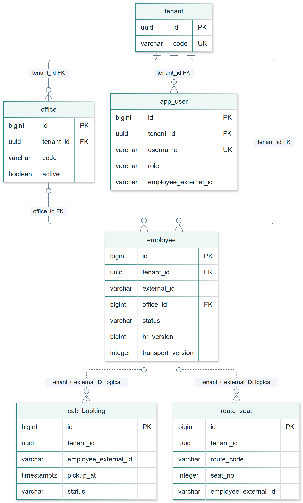
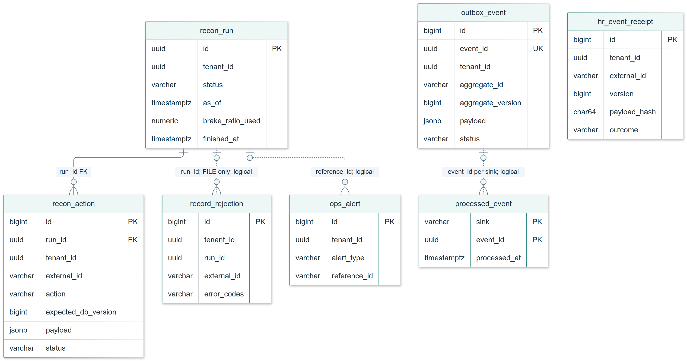

# Schema guide

The diagrams describe the implemented PostgreSQL schema in Flyway V1-V4. They show selected columns so keys and lifecycles remain readable; [DATA_MODEL.md](DATA_MODEL.md) contains the full definitions. No schema changes are part of these figures.

## Employee and transport records

Solid lines are declared SQL foreign keys. Dotted lines are application-level references, resolved with the tenant and external employee ID; they are not database foreign keys. Crow's-foot ends mean many rows; a circle marks an optional association. PK is a primary-key column and UK is an individually unique column. Composite unique keys are listed below rather than implying that external IDs are globally unique.

`employee` stores the HR-owned and transport-owned columns together, with independent versions. Its nullable office reference allows an INACTIVE tombstone before any CREATE. Office lookup and all employee/booking/seat operations are tenant-scoped in the service/repository paths. The single-column `office_id` FK does not itself enforce tenant equality; the application selects the office inside the authenticated tenant.

`app_user.employee_external_id` is an application mapping for EMPLOYEE accounts, not a foreign key. Account preparation requires that value for EMPLOYEE; an employee can only read the matching self profile. Booking and route-seat employee references are also logical, not declared employee FKs.

## Synchronisation, audit and delivery

`hr_event_receipt` is an accepted-content ledger, not a copy of every delivery. A replay does not add another receipt. Rejected/conflicting content is audited through `record_rejection`; it cannot consume an accepted key. Reconciliation writes plans/actions, not event receipts.

`outbox_event` stores a pending event in the same transaction as the employee change. `aggregate_id` refers to an employee external ID or a run ID according to `aggregate_type`; this is a polymorphic logical reference. `processed_event` belongs to the consumer and is unique per `(sink,event_id)`. There is no SQL FK between it and the outbox, and each has its own retention lifecycle. `ops_alert.reference_id` can refer to different operational objects, so it is not a declared FK either.

`recon_action.run_id` is a real FK. `record_rejection.run_id` is an optional logical association used for FILE rejections. Run rows/counters remain for audit after terminal action payloads and upload copies expire. See [retention and hash compatibility](DATA_MODEL.md).

## Full relationship map

[Open the full vector diagram](diagrams/schema-full.svg) or its [editable Mermaid source](diagrams/schema-full.mmd). The full view includes all 14 application tables, including `tenant_settings`. It retains the same solid-FK/dotted-logical legend; routine `tenant_id` scoping in audit tables is not redrawn as a forest of implied FKs.

## Keys that enforce the guarantees

| Table | Constraint / lookup | Why it matters |
|---|---|---|
| `tenant` | unique `code` | Stable company code in issued tokens |
| `app_user` | globally unique `username`; tenant FK | Login identifies the prepared account and company |
| `office` | unique `(tenant_id,code)` | Two companies may use the same office code |
| `employee` | unique `(tenant_id,external_id)` | HR identifiers belong to a company |
| `hr_event_receipt` | unique `(tenant_id,external_id,version)` | Concurrent same-key requests share one accepted result |
| `recon_run` | one UPLOADED/DIFFING/APPLYING/AWAITING_APPROVAL row per tenant | Prevent overlapping live plans; terminal PLANNED is excluded |
| `recon_action` | unique `(run_id,external_id)` | One resolved plan action per employee in a run |
| `outbox_event` | unique `event_id`; due-PENDING index | Stable delivery identity and efficient queue claims |
| `processed_event` | primary key `(sink,event_id)` | Redelivery does not repeat one consumer's effect |
| `route_seat` | unique `(tenant_id,route_code,seat_no)` | A route seat is unique within its company |

The declared FKs are exactly: tenant_settings→tenant, office→tenant, app_user→tenant, employee→tenant, employee→office and recon_action→recon_run. The other arrows describe application semantics, not additional constraints.
